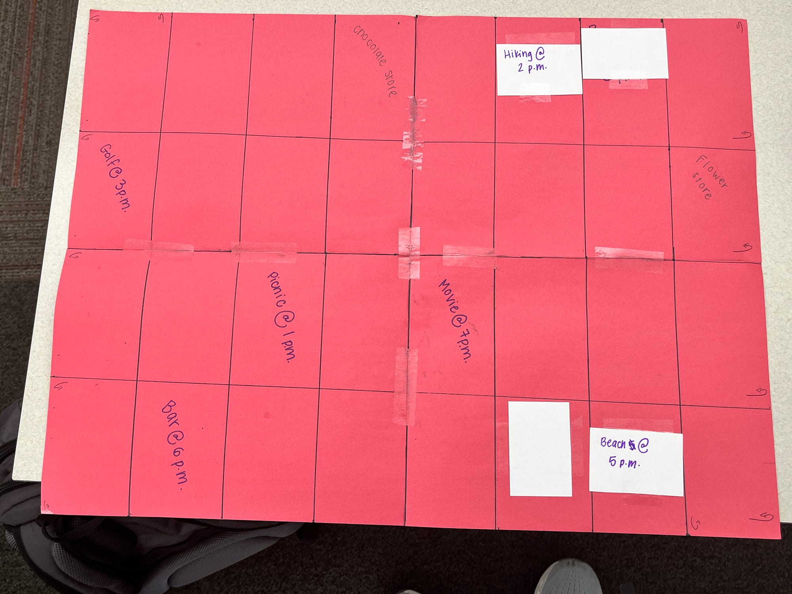
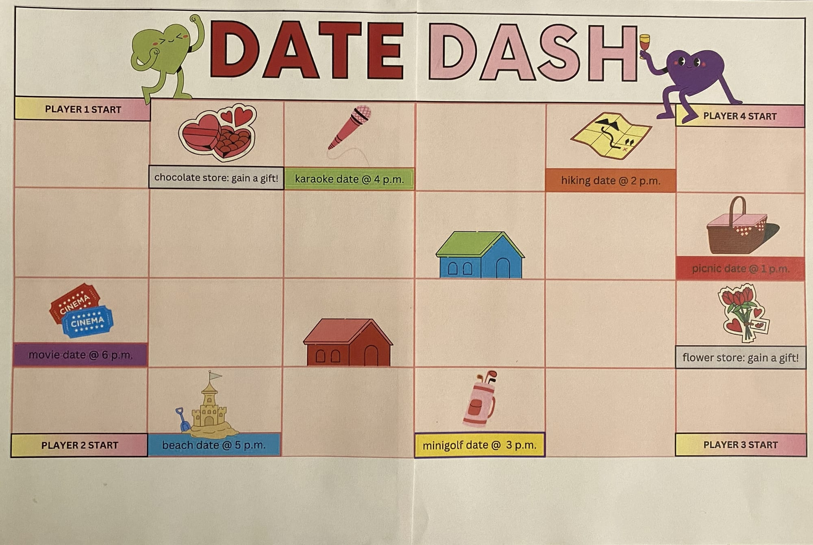

{/* LAYOUT TEST — placeholder text, replace with the real write-up. */}

Placeholder paragraph to show the text column width. The image below is a regular Markdown image, so it stays exactly as wide as this text.

The next image is wrapped in `<Wide>`, so it breaks out of the text column to the same width as the cover image above.

<Wide>
  
</Wide>

Text after a wide image drops back to the normal column width.
