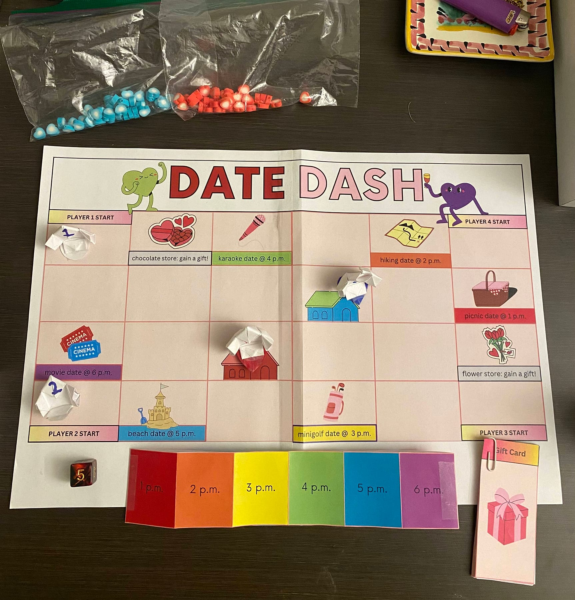
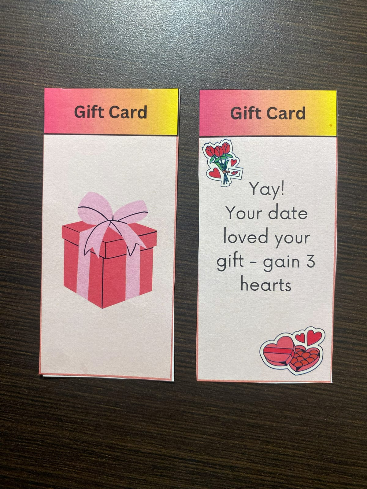
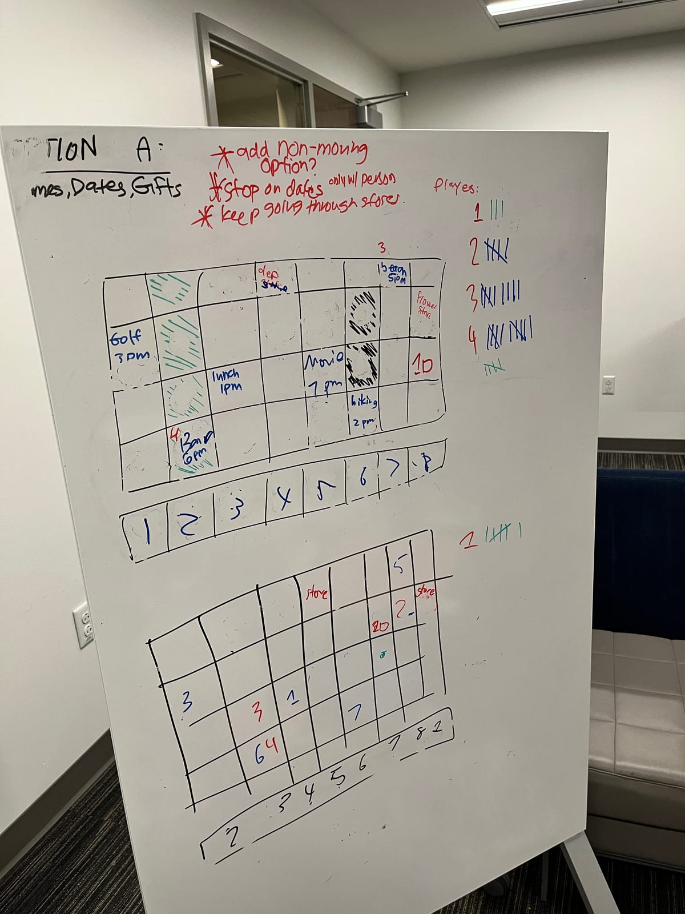
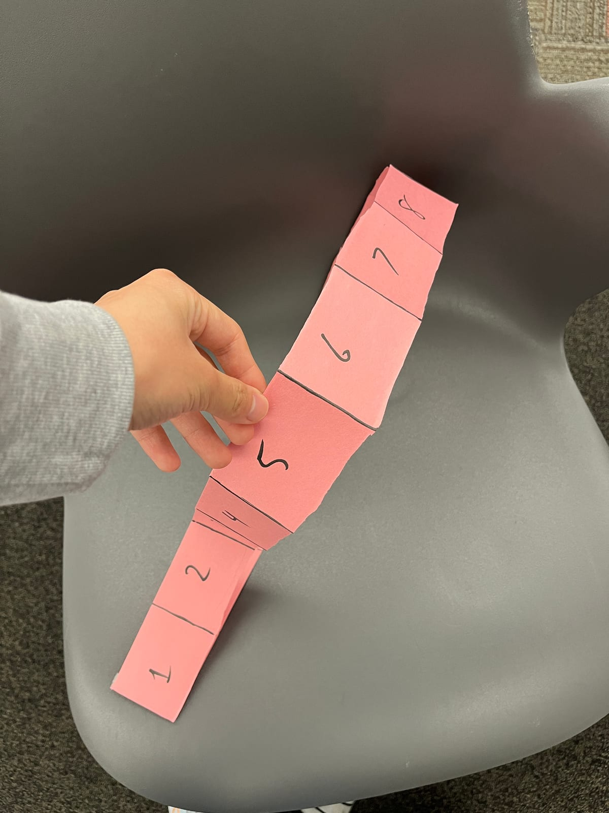
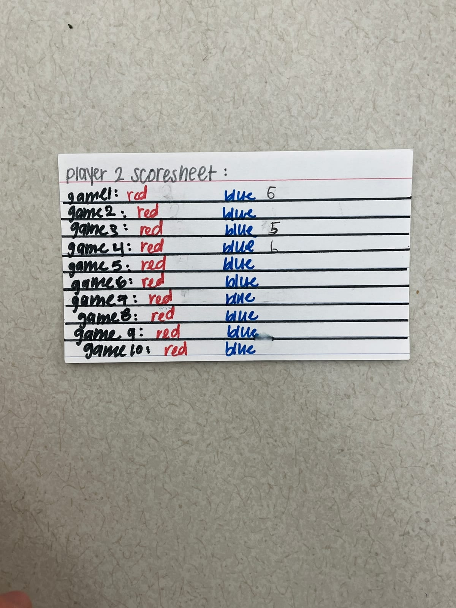
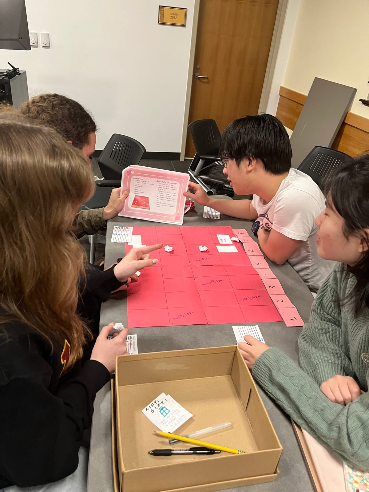
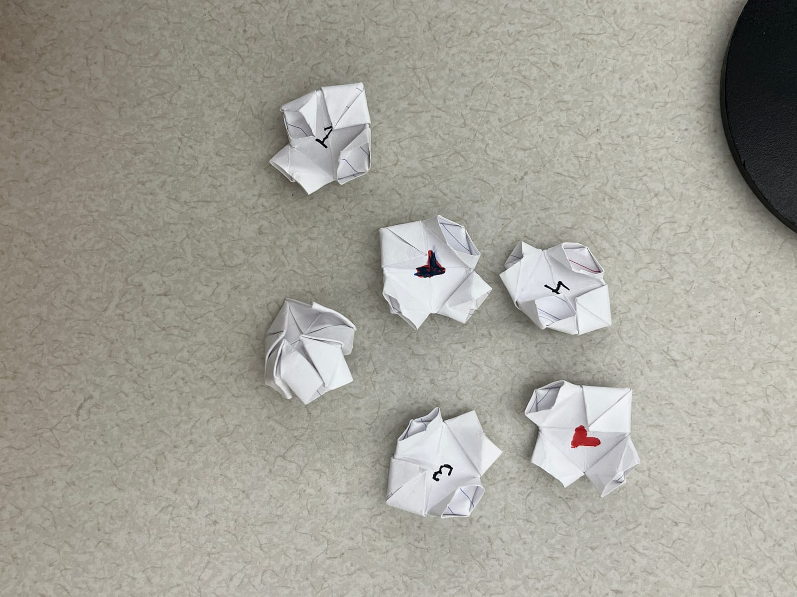
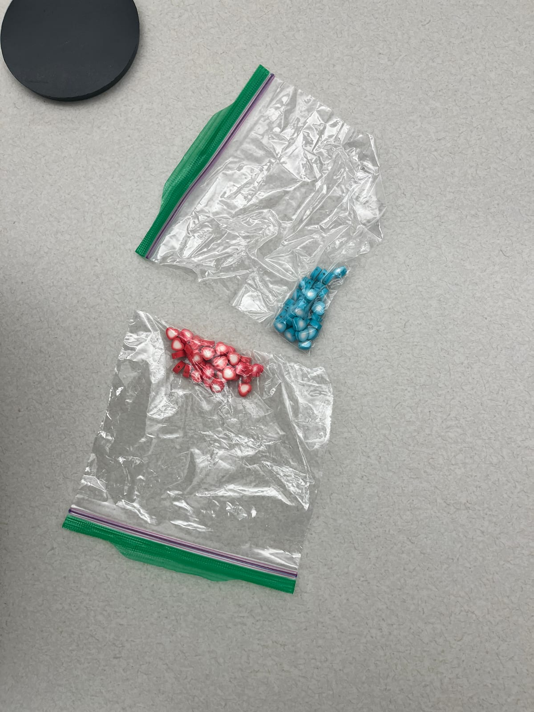
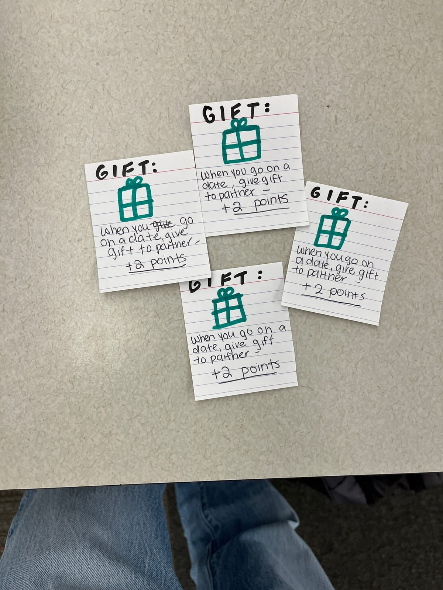
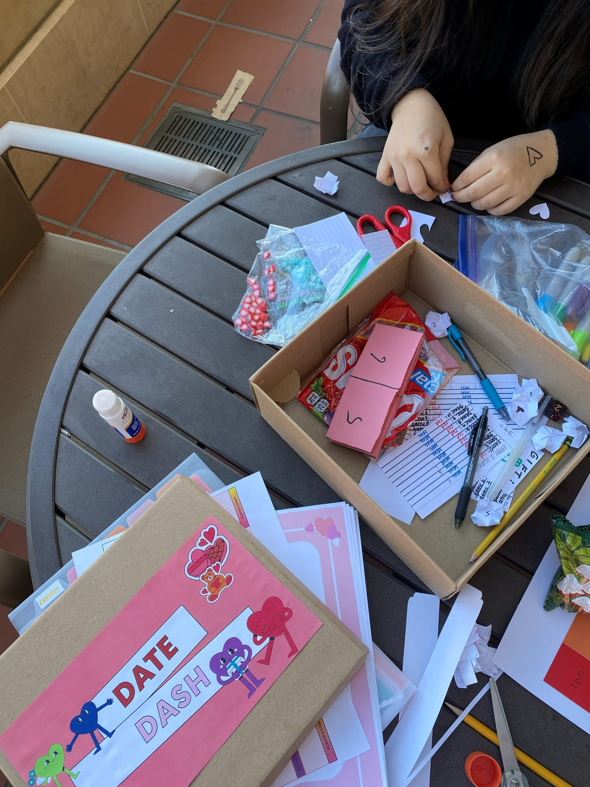

I bet a lot of you have played *Up the River*. You roll the dice and race your boats to the harbor, but the river keeps moving: every round the whole board slides down a row, so you're always fighting the current. And of course you get to troll your friends by sending their boats back down.

Date Dash is our respectful rip-off of it. Same idea, a board that keeps changing under you, but instead of boats you're chasing dates. We came up with it around Valentine's Day, and it turned out pretty good. Good enough that we actually reached out to Tinder to see if they wanted to buy it. They never replied lol.

## The game

Four players, two significant others: one red, one blue. They're shared pawns that start at their homes in the middle of the board (the two little houses in the picture), and everybody is chasing the same two people. Take them on dates, collect hearts in their color, and whoever hits 10 hearts of one color first wins.

On your turn, roll a d6. That's how many steps you get, and a step can be:

- **Move** one square. No diagonals.
- **Pick up** a significant other standing on your square, or **steal** one from whoever's dragging them around. Yes, you can take both.
- Walk through a **store** and grab a gift (the card in the bottom right of the picture). This one's free, but you can only hold one, and no peeking.

Walk onto a date spot with someone in tow and you're on a date. That ends your turn.

<Wide caption="The full set: board, pawns, time belt, gift cards, die and heart counters">
  
</Wide>

Every date spot has an ideal time: picnic at 1 pm, movie at 6 pm, and so on. The current time comes from the **time belt**, the rainbow strip under the board. Whatever hour is under a column, that's the time for the whole column. After each round, player 1 slides the belt forward an hour, so the best date spot keeps moving around. That's our version of the moving river.

A date is worth 5 hearts, minus 1 for every hour you're off. Picnic at 4 pm? 5 − 3 = 2 hearts. You can't go below 0.

Then you hand over your gift and flip it. The back says how much they liked it, anywhere from −1 to +3. After the date they go back home, and everyone else can go wait outside their house for round two.

<Figure caption="A gift card, front and back. This one's a +3">
  
</Figure>

If you wanna hand-in play, I orgnize everything's on [Google Drive](https://drive.google.com/drive/folders/18XkcQg4dMfbmGP0OU5NPrlnIXPvBp5xo?usp=drive_link): rules, board, time belt and gift cards. Just print out and buy a dice-6.

## The iterations

### Start: a whiteboard

Our first experience goal: *players will feel desperation as they try to win someone's love by Valentine's Day.*

<Figure caption="The first whiteboard sketch">
  
</Figure>

We drew the board on a whiteboard and played it right there. It broke pretty fast:

- After a date the significant other just stayed on the date spot, so you could camp there forever. So now they walk 4 squares away after every date.
- Picking someone up was free, so once one player had both significant others, they never split up again. So now it costs a step.

We were also missing the best part of *Up the River*: the moving board. Sliding the whole board by hand every round sounded awful, so we moved the clock instead. A paper loop with the hours on it sits under the board and shifts one hour each round. That's the time belt.

We also let players walk off one edge and come out the other side, like Pac-Man. Remember that one, it comes back.

<Figure caption="First paper prototype">
  
</Figure>

<Figure caption="The first time belt: just a paper loop">
  
</Figure>

### First playtest: 40 minutes of heart farming

The first time people outside our team played, it dragged on for **40 minutes and 22 turns**.

Remember the "walk 4 squares away" rule? Turns out the movie and mini golf spots were exactly 4 squares apart, and both were at their best time. So two players just passed the same person back and forth between those two spots and farmed hearts all game. Nobody touched red once. Half the game basically didn't exist. We moved the date spots around to break that loop.

Some players also thought the 10 boxes on the scorecard meant 10 turns, and nobody got the date math. So the rules now just say "subtract however many hours you're off" with an example. The scorecard got fixed later.

Words were a problem in general. Someone actually spent a move at a store, because our rules said "buy." Another player called the time belt a "timezone," and we seriously talked about giving everyone a private jet to explain it lol.

<Figure caption="The old scorecard, before we switched to real hearts">
  
</Figure>

### Public playtest: the players changed our goal

Nobody cared about winning. They were too busy making up stories: *"you go on dates 1 hour early every time,"* *"they took my gift and ran."*

<Figure caption="The public playtest">
  
</Figure>

The drama was obviously the fun part, so we rewrote the experience goal: *players feel tension and determination while experiencing a turbulent and complex relationship dynamic.* Then we cut anything that didn't help with that. Pac-Man walking went first. We'd drawn arrows on the board to explain it, and the arrows just confused people more.

Also, everyone kept calling our origami pawns fortune tellers. So we gave them stands, and once they were standing up they finally looked like people.

<Figure caption="Our pawns. Yes, they look like fortune tellers">
  
</Figure>

The same day, I ran a playtest with my friends. Our rules were written like a glossary, with the same rule showing up in a bunch of sections, and they got annoyed reading the same thing three times. But they loved the "Frequently Missed Rules" page. So we cut the repeats and kept that page.

They also said there wasn't much strategy. We left that alone on purpose. The game was about drama now, not about outsmarting each other.

### Redesign

We took everything from the playtests and rebuilt the game in one meeting:

- **Significant others got homes.** They go home after a date, so players can camp outside their house. More drama, and way easier to get than "walk 4 squares away."
- **Smaller board, shorter game.** The board went from 8×4 to 6×4, and the win went from 15 hearts down to 10.
- **Random gifts.** A gift used to be a flat +2. Now it's a face-down card from −1 to +3. Getting a 3 feels great, getting a −1 hurts.
- **Real hearts.** No more scorecards, just bags of red and blue heart counters.

<Figure caption="The heart counters that replaced the scorecards">
  
</Figure>

<Figure caption="The first gift cards, all a flat +2">
  
</Figure>

When we tested the new board ourselves, nobody ever went to the date spots on the left. So we made the layout almost symmetrical: homes in the middle, date spots around the edges, one player start in each corner. That's the board at the top of this page.

### Arts and crafts hour

With the rules finally settled, we made the real thing. Pretty much all by hand again. We went through a kindergarten craft session :)

<Figure caption="Craft time: the box, heart counters and paper pieces">
  
</Figure>

### Final playtest: 20 minutes

Down to **20 minutes**, half of the first playtest. New complaints: rolling a 6 is too strong, rolling a 1 is too weak, and karaoke was so close to a home that everyone piled in there the first couple of rounds.

We kept the dice as they were. *"This game is great until you roll 1 3 times,"* one player said, but nobody really minded. Bad rolls left everyone stuck camping outside the same house, and honestly that was the funniest part of the whole session. One player "slept around too much" and took both significant others on a date at once. 

Pretty sure that means the game works. The mess was what we want. 
I still dream that Tinder will buy our game. 
