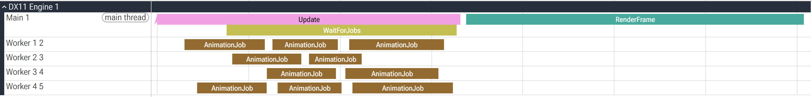
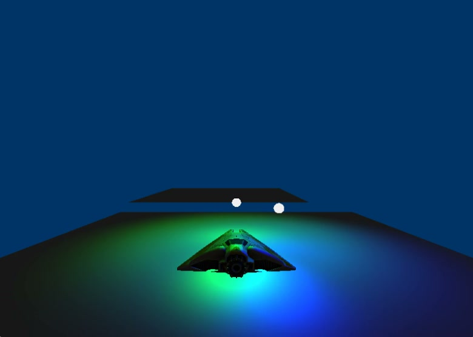
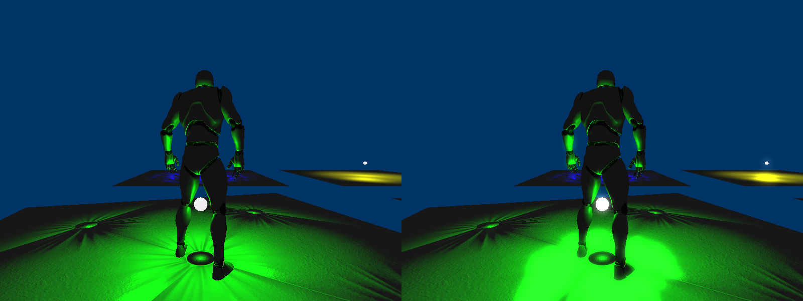
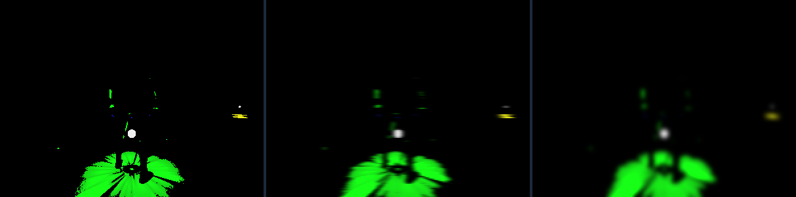

import trailer from './trailer.mp4';
import texturedCube from './textured-cube.mp4';
import normalMap from './normal-map.mp4';
import run from './run.mp4';
import states from './states.mp4';
import ik from './ik.mp4';

After some development with game engines, I kept wondering how things actually get drawn under the hood. So I built this engine on DirectX 11. I want to thank Professor Matthew Whiting for providing the foundational code. It helped a lot. The engine basically recreates the rendering pipeline (from coordinates to the screen), fragment processing (lights, textures, etc.), and also covers a basic animation system (FK, IK), a multithreaded job system, and more.

The whole engine doesn't use any existing engine or rendering library with only DirectXTK to read textures and RapidJSON to read files.

This was a really challenging project for me, because before this I knew nothing about rendering and only half understood linear algebra. After this project, those basics are a lot more solid now.

Here's the overview video.

<Wide>
  <Video src={trailer} wide controls />
</Wide>

## Engine structure

### What's happening in each frame?

Each frame has two steps. **Update** first lets every object in the scene update its components. Characters drop their animation work into the job queue at this step, and then the main thread waits for all the jobs to finish. **Render** first draws the whole scene to an off-screen texture, then does Bloom, and finally composites it to the screen.

```cpp title="game.cpp"
void Game::Update(float deltaTime)
{
	for (RenderObj* obj : mRenderObjs)
	{
		obj->Update(deltaTime);   // update each object's components; characters hand their animation to a job here
	}
	JobManager::Get()->WaitForJobs();   // wait for all animation jobs to finish before drawing
}
```

<Wide xl caption="One frame: Update hands 10 AnimationJobs to 4 worker threads, waits for them, then renders.">
  
</Wide>

The scene itself is a JSON level file. Each object lists its position and model, then has a list of components attached, like a point light, character, player control, follow camera, or collision box. When loading, it creates the matching component based on `"type"`.

```json title="Level11.itplevel"
{
    "position": [ 0.0, 0.0, 50.0 ],
    "scale": 0.5,
    "mesh": "Assets/Meshes/LightSphere.itpmesh3",
    "components": [
        {
            "type": "PointLight",
            "lightColor": [ 0.0, 1.0, 0.0 ],
            "innerRadius": 125.0,
            "outerRadius": 250.0
        }
    ]
}
```

Models, materials, textures, skeletons and animations are all loaded through an `AssetCache` template. Each file is only read the first time it's asked for. After that, the cache just returns the same pointer.

```cpp title="assetCache.h"
T* Load(const std::wstring& fileName)
{
    auto iter = mAssetMap.find(fileName);
    if (iter != mAssetMap.end())
        return iter->second;                               // already loaded, return it
    T* asset = T::StaticLoad(fileName.c_str(), mManager);  // each asset type implements its own StaticLoad
    if (nullptr != asset)
        mAssetMap[fileName] = asset;
    return asset;
}
```

## Rendering

### From triangle to materials

I started by creating the DX11 device, swap chain and buffers to draw the first triangle, then added a camera and a cube, then textures, then materials. Constant buffers are split into a few fixed slots by purpose: one for the camera (view-projection matrix and camera position), one per object (model-to-world matrix), one for lighting, and one for bones. Each one is uploaded on its own, right before it's used.

A material is just shader + texture + diffuse color + specular color and power, and it's also read from a file. When drawing an object, it first calls `SetActive()` on the material, then draws the vertices.

<Figure caption="A textured, lit cube spinning in front of the first triangle">
  <Video src={texturedCube} />
</Figure>

### Lighting

The lighting is Phong: ambient + diffuse + specular. A scene has at most 8 point lights. Each light has an inner radius and an outer radius: fully bright inside the inner radius, then slowly falling off to 0 at the outer radius. I used `smoothstep` here instead of linear, so the edge is softer (smoothstep's slope is 0 at both ends, so there's no hard line).

```hlsl title="Phong.hlsl"
for (int i = 0; i < MAX_POINT_LIGHTS; ++i)   // at most 8 point lights
{
    PointLightData light = c_pointLight[i];
    if (light.isEnabled)
    {
        float3 lightDir = light.position - pIn.worldPosition;
        float distance = length(lightDir);
        lightDir = normalize(lightDir);
        // 1 inside the inner radius, smoothly down to 0 at the outer radius
        float attenuation = 1.0f - smoothstep(light.innerRadius, light.outerRadius, distance);
        float3 diffuseColor = light.lightColor * max(dot(normal, lightDir), 0.0f) * c_diffuseColor;
        float3 reflectDir = reflect(-lightDir, normal);
        float3 viewDir = normalize(c_cameraPosition - pIn.worldPosition);
        float3 specColor = light.lightColor * pow(max(dot(reflectDir, viewDir), 0.0f), c_specularPower) * c_specularColor;
        accumulatedLight += (diffuseColor + specColor) * attenuation;
    }
}
```

A point light is also a component. It asks Game for a light slot and writes its object's position into it every frame, so whatever it's attached to, the light follows.

<Figure caption="A green and a blue point light shining on the platform and the ship">
  
</Figure>

### Normal mapping

The platform itself is flat, but it should look bumpy, which is the classic use for a normal map. The way it works is each vertex carries an extra tangent, and in the pixel shader the cross product of the normal and tangent gives the bitangent, which together make the TBN matrix (more details on my [Notes page](/notes/material-properties)). The normal map stores colors from 0 to 1, so they first get mapped back to -1 to 1, then turned into world space with the TBN, and after that the lighting is the same as above.

```hlsl title="Normal.hlsl"
float3 tangent = normalize(pIn.tangent);
float3 biTangent = normalize(cross(pIn.normal, pIn.tangent));   // the third axis comes from a cross product
float3 normal = normalize(pIn.normal);
float3x3 TBN = float3x3(tangent, biTangent, normal);
float3 nMap = NormalMap.Sample(DefaultSampler, pIn.texCoord).rgb * 2.0f - 1.0f;   // color [0,1] → direction [-1,1]
float3 nW = normalize(mul(nMap, TBN));   // tangent space → world space; lighting uses nW from here
```

The level has three platforms with different normal maps, plus a component that keeps them spinning, so you can see the bumps change as the light moves across them.

<Figure caption="Running from the green platform and jumping onto the blue one. Both are flat, the bumps come from the normal maps">
  <Video src={normalMap} />
</Figure>

### Bloom

Bloom is the most complicated part of this section. It uses several render targets and passes the image back and forth between them. The whole process goes like this:

1. The scene is first drawn to a full-resolution off-screen texture instead of straight to the screen.
2. It's drawn to a **half-resolution** texture, keeping only the bright parts: any pixel whose largest RGB value is under 0.8 turns black.
3. Then it's shrunk to **1/4 resolution**. Blurring on a small image is cheap, and the blur also looks wider.
4. Gaussian blur. Gaussian blur is separable, so it's split into one horizontal pass and one vertical pass, 9 samples each, instead of 9×9 = 81 at once. Two 1/4-size textures get reused back and forth: the horizontal pass writes from #1 to #2, and the vertical pass writes from #2 back to #1.
5. Back to the screen: first draw the original image normally, then add the blurred highlights on top with additive blending (ONE + ONE).

```hlsl title="BloomMask.hlsl"
float4 texColor = DiffuseTexture.Sample(DefaultSampler, pIn.texCoord);
float threshold = max(max(texColor.r, texColor.g), texColor.b);   // look at the brightest channel
if (threshold < 0.8)
    return float4(0, 0, 0, texColor.a);   // not bright enough, turn it black
else
    return texColor;
```

```hlsl title="Blur.hlsl"
// 5 weights: the center + 4 on each side = 9 samples
static const float weights[5] = { 0.227027f, 0.1945946f, 0.1216216f, 0.054054f, 0.016216f };

float4 PS(VOut pIn) : SV_TARGET
{
    float2 step = uTexelSize * uDirection;   // uDirection is (1,0) horizontal or (0,1) vertical
    float4 c = DiffuseTexture.Sample(DefaultSampler, pIn.uv) * weights[0];
    for (int i = 1; i < 5; ++i)
    {
        c += DiffuseTexture.Sample(DefaultSampler, pIn.uv + step * i) * weights[i];
        c += DiffuseTexture.Sample(DefaultSampler, pIn.uv - step * i) * weights[i];
    }
    return c;
}
```

```cpp title="game.cpp"
// horizontal: quarter 1 → quarter 2
mGraphics.SetRenderTarget(mQuarterResRTV2, nullptr);
BlurParams paramsH = { texel, Vector2(1.0f, 0.0f) };
mGraphics.GetDeviceContext()->UpdateSubresource(mBlurCB, 0, nullptr, &paramsH, 0, 0);
mQuarterResTex1->SetActive(0);
mCopyVB->Draw();   // a quad that fills the screen

// unbind quarter 2 from the input first, otherwise the next step can't write into it
Graphics::Get()->SetActiveTexture(0, nullptr);

// vertical: quarter 2 → quarter 1
mGraphics.SetRenderTarget(mQuarterResRTV1, nullptr);
BlurParams paramsV = { texel, Vector2(0.0f, 1.0f) };
// ...same as above

// back to the screen: draw the original opaque, then add the blurred highlights with additive blending
mGraphics.SetBlendState(mBlendOpaque);
mOffscreenTexture->SetActive(0);
mCopyVB->Draw();
mGraphics.SetBlendState(mBlendAdditive);
mQuarterResTex1->SetActive(0);
mCopyVB->Draw();
```

The mask and blur passes run in the fragment shader, or the pixel shader if you'd rather call it that.

<Wide caption="The same frame with Bloom off (left) and on (right)">
  
</Wide>

<Wide caption="The render targets in between: the brightness mask at half resolution, then the horizontal blur and the vertical blur at 1/4 resolution">
  
</Wide>

## Animation

### Skeleton and skinning

The character is a Mannequin model with 68 bones (the engine supports up to 80), and it has idle, walk, run, jump start, in-air and landing animations.

Each bone stores its rotation and translation relative to its parent bone. When the skeleton is loaded, it also computes each bone's **inverse bind pose**: first multiply down the parent chain to get the bone's global matrix in the bind pose, then invert it. This matrix moves a vertex from model space into "this bone's own space".

```cpp title="Skeleton.h"
void ComputeGlobalInvBindPose()
{
    inverseBondPoseMatrices.resize(mBones.size());
    for (int i = 0; i < mBones.size(); i++)
    {
        Matrix4 localBindPose = mBones[i].boneTransform.ToMatrix();
        if (mBones[i].parentIndex >= 0)
            // the parent always comes first, so its global matrix is already done
            inverseBondPoseMatrices[i] = localBindPose * inverseBondPoseMatrices[mBones[i].parentIndex];
        else
            inverseBondPoseMatrices[i] = localBindPose;
    }
    for (auto& m : inverseBondPoseMatrices)
        m.Invert();   // invert them all once everything is computed
}
```

When playing an animation each frame, it first uses the current time to find the two frames before and after, interpolates the pose in between (lerp for translation, slerp for rotation), then does FK: it multiplies down the parent chain to get each bone's global matrix. After the last frame it interpolates with the first frame, so looping animations connect.

```cpp title="Animation.cpp"
float timePerFrame = mAnimationLength / static_cast<float>(mFramesNum - 1);
int frame0 = static_cast<int>(floor(inTime / timePerFrame));
int frame1 = frame0 + 1;
float frac = (inTime - frame0 * timePerFrame) / timePerFrame;   // how far between the two frames

for (size_t i = 0; i < bones.size(); ++i) {
    // lerp the translation, slerp the rotation
    BoneTransform interpBT = BoneTransform::Interpolate(keyFrames[k0], keyFrames[k1], frac);
    Matrix4 localMatrix = interpBT.ToMatrix();

    int parentIndex = bones[i].parentIndex;
    if (parentIndex >= 0)
        outPoses[i] = localMatrix * outPoses[parentIndex];   // stack it on the parent
    else
        outPoses[i] = localMatrix;
}
```

In the end each bone's skin matrix is inverse bind pose × current global pose, and all the skin matrices go to the GPU together as a constant buffer. In the vertex shader each vertex is affected by up to 4 bones, and the 4 results are added up by weight. The normal has to be transformed too, otherwise the lighting is wrong.

```hlsl title="Skinned.hlsl"
for (int i = 0; i < 4; i++)   // up to 4 bones per vertex
{
    skinnedPos += mul(float4(vIn.position, 1.0), c_skinMatrix[indices[i]]) * vIn.boneWeights[i];
    // normal has w = 0, so it only rotates and doesn't move
    skinnedNormal += (mul(float4(vIn.normal, 0.0), c_skinMatrix[indices[i]])).xyz * vIn.boneWeights[i];
}
float4 worldPos = mul(skinnedPos, c_modelToWorld);
```

<Figure caption="The Mannequin's run cycle">
  <Video src={run} />
</Figure>

### Character states

The player is a small state machine: IDLE, WALK, JUMP, FALL, LAND. Each state switches to an animation when you enter it. For example, entering JUMP plays the jump start animation and gives an upward velocity, after the jump start animation finishes it switches to the in-air loop, touching the ground enters LAND, and when the landing animation finishes it goes back to IDLE.

```cpp title="player.cpp"
case State::WALK:
    if (mGame->IsKeyHeld(VK_SPACE))
        SetState(State::JUMP);
    else if (false == isOnGround)
        SetState(State::FALL);          // walk off the edge of a platform and start falling
    else if (mVel.LengthSq() < 0.0001f)
        SetState(State::IDLE);
    break;
case State::JUMP:
    if (mCurrentTime < mPrevAnimTime)   // time wrapped around = the jump start animation played once
        SetAnim("jump");                // switch to the in-air loop
```

Whether there's ground under the feet is tested with a vertical ray, which I'll cover in the collision part below.

<Figure caption="Walking, jumping onto the blue platform, landing, then walking off the edge and falling">
  <Video src={states} />
</Figure>

### IK

On top of the animation I also added IK, so the character's right hand reaches for a target. The bone chain is the four joints of the right arm: upper arm, forearm, hand, middle finger. The target is a glowing ball that flies back and forth along a figure-eight path (it's also a point light itself).

IK hooks in after the animation: once the character finishes computing this frame's bones, it calls a callback, the IK component changes the bone rotations directly in that callback, and then the skin matrices get computed. So the animation system itself doesn't need to know IK exists at all.

```cpp title="character.cpp"
mCurAnim->GetBoneTransforms(bones, mSkeleton, mAnimTime);   // compute the animation as usual first
if (mCustomAnim)
{
    mCustomAnim(bones);   // IK changes the bones here
}
Animation::BonesToGlobalPose(bones, outPoses, mSkeleton);   // then compute the global pose and skinning
```

I originally wanted to use CCD, but handling translation sounded simpler than handling joint rotation, and I wasn't planning to limit the arm's max angle anyway, so **FABRIK** was more convenient. First the target position is moved into the character's model space, then the chain gets pulled in two passes:

1. **Backward**: put the end right on the target, then walk toward the root, pulling each joint back to its original bone length along the direction "pointing to the next joint".
2. **Forward**: put the root joint back where it was, then walk toward the end again, also keeping the bone lengths.

```cpp title="ikChain.cpp"
std::vector<Vector3> p = origPos;
p[n - 1] = targetModel;   // put the end right on the target
for (int i = n - 2; i >= 0; --i)   // backward: from the end to the root
{
    Vector3 dir = p[i] - p[i + 1];
    float   r = dir.Length();
    if (r > 1e-5f)
        p[i] = p[i + 1] + dir * (linkLen[i] / r);   // pull back to the original bone length
}

p[0] = origPos[0];   // put the root joint back
for (int i = 0; i < n - 1; ++i)    // forward: from the root to the end
{
    Vector3 dir = p[i + 1] - p[i];
    float   r = dir.Length();
    if (r > 1e-5f)
        p[i + 1] = p[i] + dir * (linkLen[i] / r);
}
```

What FABRIK gives you is only joint **positions**, but bones need **rotations**. So they have to be converted back one joint at a time: in that joint's own space, compare "the direction to the child joint in the bind pose" with "the direction it should point now", use the cross product as the rotation axis and the dot product for the angle, get a quaternion, and stack it on the original rotation. Once a joint is changed, its matrix becomes the parent matrix of the next joint. When I got to this step I suddenly realized CCD might have been the better way, but whatever.

```cpp title="ikChain.cpp"
Vector3 origDir = C.mPos;   // in the bind pose, the child joint's direction from this joint
origDir.Normalize();
Vector3 desiredDir = Matrix4::Transform(modelDir, invJoint, 0.0f);   // the direction FABRIK wants, moved into joint space
desiredDir.Normalize();

float cosA = Math::Clamp(Vector3::Dot(origDir, desiredDir), -1.0f, 1.0f);
Vector3 axis = Vector3::Cross(origDir, desiredDir);   // rotation axis
axis.Normalize();
Quaternion ikRot = Quaternion(axis, acosf(cosA));     // how much to rotate

Quaternion newRot = Quaternion::Concatenate(ikRot, J.mRot);
bones[jointIdx].mRot = newRot;
// this joint's new matrix is the next joint's parent matrix
parentModel = Matrix4::CreateTranslation(J.mPos) * Matrix4::CreateFromQuaternion(newRot) * parentModel;
```

When the two directions almost line up or point exactly opposite, the cross product is 0, so those two cases are handled separately: lined up means no rotation, opposite means rotate 180 degrees around the Y axis.

The current limits, plainly: each frame only pulls back and forth **once**, so when the target is far away or the chain is long it won't fully reach. There's also no joint angle limit, so in theory the elbow can bend the wrong way.

<Figure caption="The right hand following the figure-eight ball. The yellow debug lines are the bone chain FABRIK computed">
  <Video src={ik} />
</Figure>

## Multithreading and profiling

### Job system

Animation work is independent for each character, so it's a good fit for other threads. I wrote a simple job system: 4 worker threads and one shared job queue locked with a mutex. There's also an atomic counter that tracks how many jobs are left, and the main thread waits at the end of Update for it to hit 0.

Each character's "compute the pose → multiply by the inverse bind pose → write the skin matrices" is one job.

```cpp title="Worker.cpp"
void Worker::Loop()
{
	while (!sShutdown.load()) {
		Job* pJob = nullptr;
		{
			std::lock_guard<std::mutex> lock(JobManager::Get()->mQueueMutex);   // only lock while taking a job
			if (!JobManager::Get()->mJobQueue.empty()) {
				pJob = JobManager::Get()->mJobQueue.front();
				JobManager::Get()->mJobQueue.pop();
			}
		}
		if (pJob) {
			pJob->DoIt();                       // no lock held while doing the actual work
			JobManager::Get()->mJobCount--;     // atomic; the main thread uses it to know when everything's done
			delete pJob;
		}
		else {
			std::this_thread::sleep_for(std::chrono::nanoseconds(1));
		}
	}
}
```

### Profiler

The profiler is a macro, `PROFILE_SCOPE(name)`, and it times whatever braces you put it in. It uses the constructor and destructor to start and stop the timer automatically, collects stats once per frame, and works out the average and max at the end.

```cpp title="Profiler.h"
#define PROFILE_SCOPE(name) \
    Profiler::ScopedTimer name##_scope(Profiler::Get()->GetTimer(std::string(#name)))

class ScopedTimer {
public:
    ScopedTimer(Timer* timer) : mTimer(timer) { if (mTimer) mTimer->Start(); }   // start timing on entering the scope
    ~ScopedTimer() { if (mTimer) mTimer->Stop(); }                              // stop automatically on leaving it
private:
    Timer* mTimer;
};
```

Every start and stop also writes an event into `profile.json` in Chrome's trace format, so you can drag it straight into chrome://tracing and see what each thread did in each frame. The frame picture in the engine structure section came from this.

Results on my machine (10 characters, Debug build):

| Section | Avg (ms) | Max (ms) |
|---|---|---|
| Update | 0.16 | 0.28 |
| AnimationJob (per character) | 0.18 | 0.42 |
| WaitForJobs | 0.13 | 0.25 |
| RenderFrame | 0.24 | 7.30 |

## Other highlights

### Math library and SIMD

All the vectors, matrices and quaternions are my own, and then I wrote a second version with SSE. One `__m128` holds exactly 4 floats, so one row of a matrix is one register. Matrix multiplication first transposes the right-hand matrix, so each element of the result is a dot product of two rows, computed with one `_mm_dp_ps` instruction each, and the mask decides which slot the result goes into. I really don't like SIMD...

```cpp title="simdMath.h"
// transpose b first (4 shuffles to pair them up, then 4 more to split them)
bT[0] = _mm_shuffle_ps(tmp0, tmp1, 0x88);
// ...
for (int i = 0; i < 4; i++)
{
    rows[i] = _mm_add_ps(
        _mm_add_ps(_mm_dp_ps(a.rows[i], bT[0], 0xF1),    // dot product goes into x
                   _mm_dp_ps(a.rows[i], bT[1], 0xF2)),   // into y
        _mm_add_ps(_mm_dp_ps(a.rows[i], bT[2], 0xF4),    // into z
                   _mm_dp_ps(a.rows[i], bT[3], 0xF8)));  // into w
}
```

### Collision

All collision is AABB. Two boxes intersect when their ranges overlap on all three axes, and it can also work out the small box where they overlap. Segment vs. box uses the slab method: for each axis, find when the segment enters and leaves that axis's range, take the latest enter time and the earliest leave time, and if it enters later than it leaves, it missed.

```cpp title="Physics.cpp"
float ood = 1.0f / d.x;
float t1 = (box.minCorner.x - p.x) * ood;   // when it hits the two faces on this axis
float t2 = (box.maxCorner.x - p.x) * ood;
if (t1 > t2) std::swap(t1, t2);
tmin = Math::Max(tmin, t1);   // latest enter
tmax = Math::Min(tmax, t2);   // earliest leave
if (tmin > tmax)
    return false;             // missed
```

`RayCast` tests every collision box in the scene and returns the closest hit. Every frame the player casts a ray from above its head down past its feet, the height it hits is the ground height, and the state machine above uses that to tell whether it's on the ground or in the air.

### Pool Allocator

Since this is an engine project and memory matters a lot in an engine, I also practiced writing a pool allocator, even though I didn't end up using it lol. It's a fixed-size memory pool. Unused slots reuse their own memory through a union to store a pointer to "the next free slot", chaining them into a free list. Allocating takes one from the head of the list and freeing puts it back at the head, both O(1), with no fragmentation.

```cpp title="PoolAllocator.h"
union Node
{
    T data;        // holds the data while in use
    Node* pNext;   // holds the next free slot while empty
};

T* Allocate()
{
    if (firstFree == nullptr)
        return nullptr;               // full
    Node* allocatedNode = firstFree;
    firstFree = firstFree->pNext;     // move the list head forward one
    return &allocatedNode->data;
}
```
