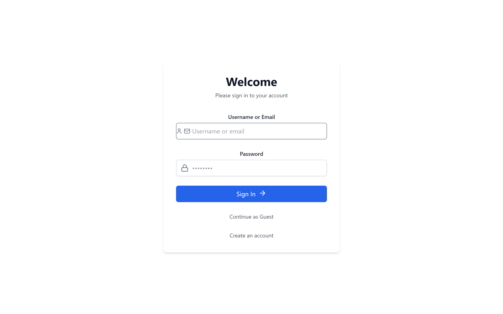
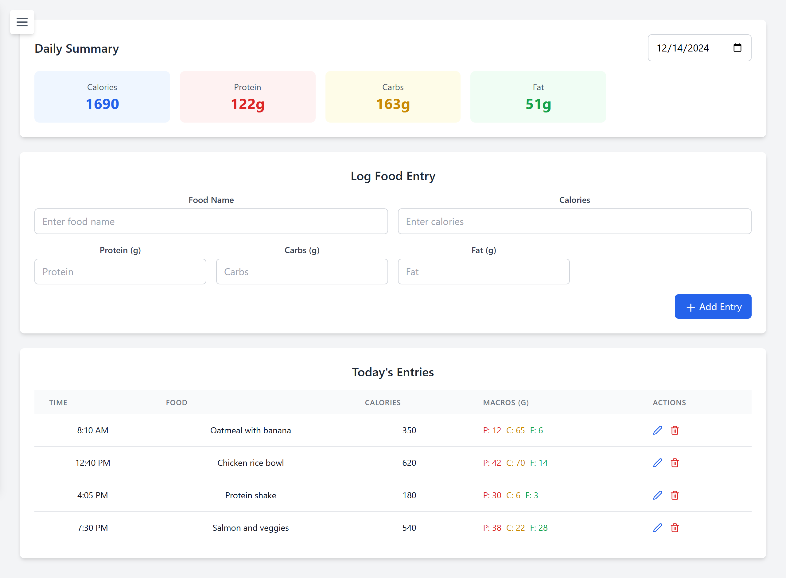

This was the final project for CSCI 201 at USC, the class where you learn backend Java, servlets, threads and SQL. Seven of us built a fitness tracker. You log what you ate, what you lifted and what the scale said, and the dashboard shows how your week went.

It was my first time doing full-stack development. It's a simple project, but I think it's still worth putting here.

My part was the login backend, first as a servlet and then in Spring Boot. More on that below.

## The app

You sign in with your username or email, or skip it and continue as a guest. Guests can click around and see example entries, but nothing gets saved.

<Figure caption="The sign-in page">
  
</Figure>

Once you're in, there are four pages behind the sidebar. Body Weight, Calories and Workout each have a form to add an entry and a table where you can edit or delete old ones. Calories also tracks protein, carbs and fat and adds up the day for you. The Dashboard shows your weight over the last 7 days, calories per day for the week, how many workouts you did this week, and your three latest entries.

<Wide caption="The calorie page: add a meal, see the day's totals, edit or delete entries">
  
</Wide>

The screenshots are the real React frontend with demo data, since the original database lived on our laptops and is long gone.

The stack is React with Tailwind and Recharts for the charts, a Spring Boot REST API, and MySQL. React runs on port 3000, Spring on 8080, and they talk over plain JSON.

## The first login

We started the backend with Java servlets on Tomcat, I know it's like last century tech, but that's what the class taught lol. I took login. My version was a `LoginServlet` that read the username and password from the form, checked them against the `User` table, and printed a welcome message back as HTML. I also made the JSP pages around it: login, create account, forgot password and continue as guest.

The one thing I made sure of was using a `PreparedStatement` instead of gluing the input into the SQL string. One of our tests was trying a SQL injection on the login, and with a prepared statement the input only ever gets treated as a value, never as SQL.

```java
String query = "SELECT * FROM User WHERE username = ? AND userPassword = ?";
PreparedStatement stmt = conn.prepareStatement(query);
stmt.setString(1, username);
stmt.setString(2, password);
ResultSet rs = stmt.executeQuery();

if (rs.next()) {
    out.println("<h1>Welcome, " + rs.getString("firstName") + " " + rs.getString("lastName") + "!</h1>");
} else {
    out.println("<h1>Invalid username or password</h1>");
}
```

I also wrote my share of the test plan, like checking that registered and guest logins both land on the dashboard, that bad calorie values get rejected, and that the workout history doesn't lag with a ton of entries.

## Moving to Spring Boot

Then I moved the whole backend to Spring Boot. The servlet returned HTML, but the frontend was React, which wants JSON and handles the page itself. Every feature would have needed the same JDBC boilerplate I wrote for login, too.

With Spring Data JPA you don't write that boilerplate. You name a method on a repository interface and Spring generates the query from the name. The new login handled username or email with this one line.

```java
// Spring writes: WHERE username = ? OR user_email = ?
Optional<User> findByUsernameOrUserEmail(String userInput, String userInputDuplicate);
```

The flow stayed the same as the servlet version, just as an API. React posts the input to `/api/auth/login`, the service looks the user up, compares the password, and sends back the user's ID. The frontend saves that ID in `localStorage` and attaches it to every request after that, like `/api/weight?userId=1`.

## Thoughts

Looking at it again, two things bother me. The first one is in both versions. Passwords were stored and compared as plain text. The column was even `VARCHAR(64)`, exactly the length of a SHA-256 hash, so I think someone planned to hash them and we never got to it. Now I'd use BCrypt, which is salted and slow on purpose.

The other one after login the server just believes whatever `userId` the browser sends, so you could change one number and read someone else's calories. The real fix is a session or a signed token, so the server works out who you are on its own.

The proposal was also a lot bigger than what we shipped. It had seven tables, workout goals that tell you when to add weight, Google login and deployment to AWS. We shipped four tables on localhost.

It was a simple project, so no complaints. I see it as my first try.
