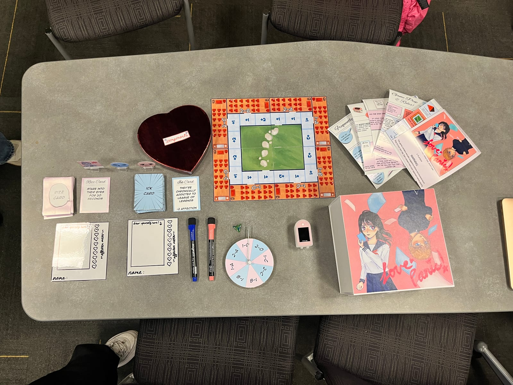
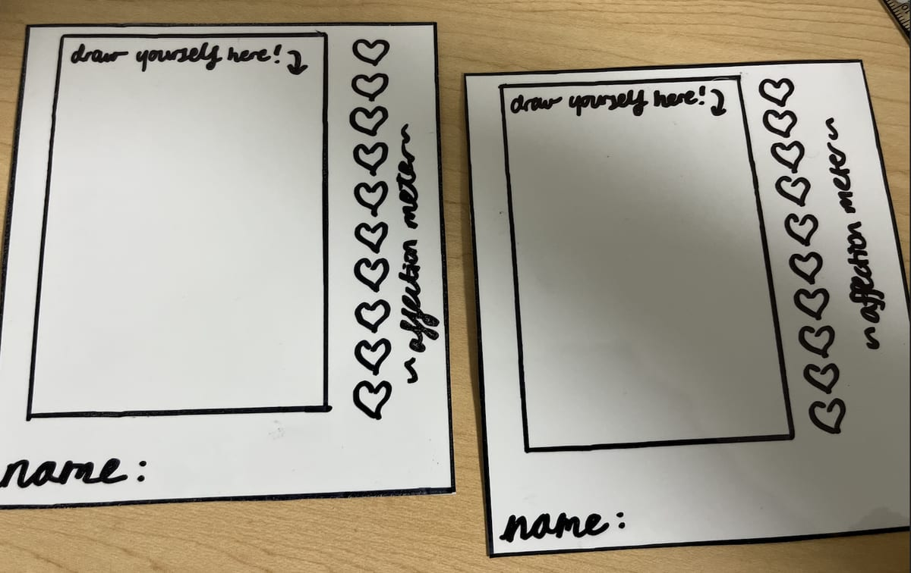
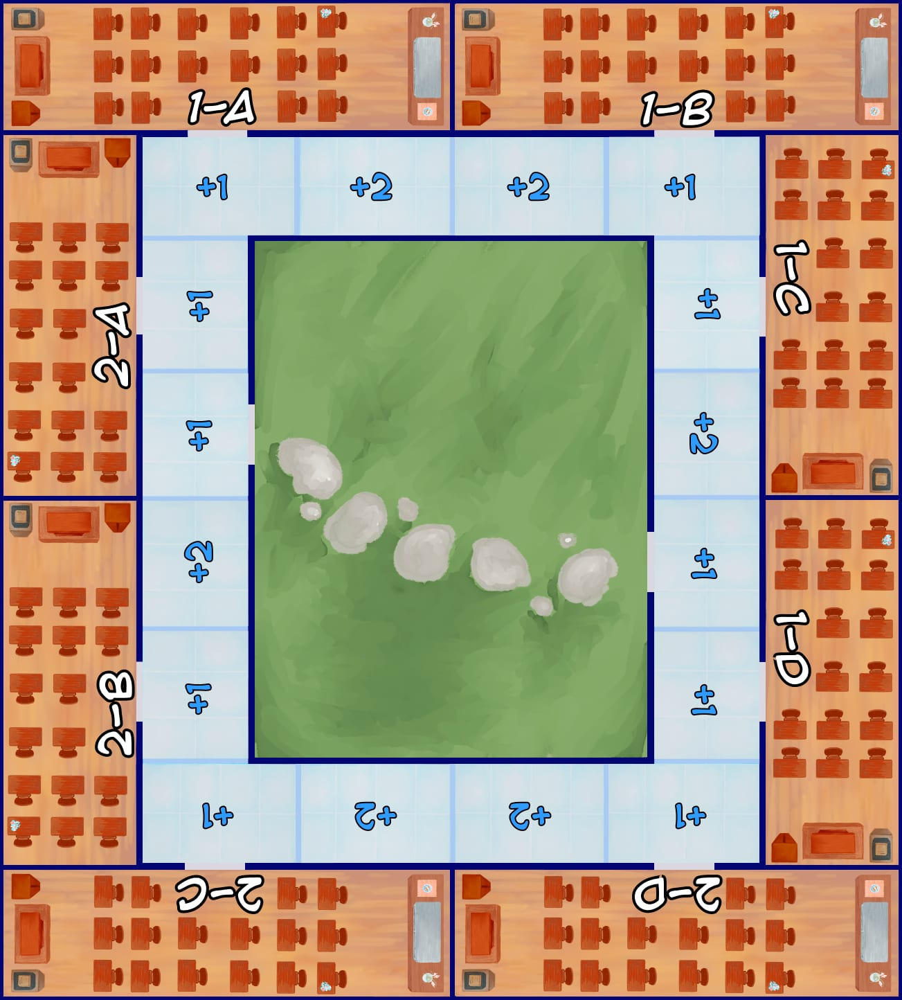
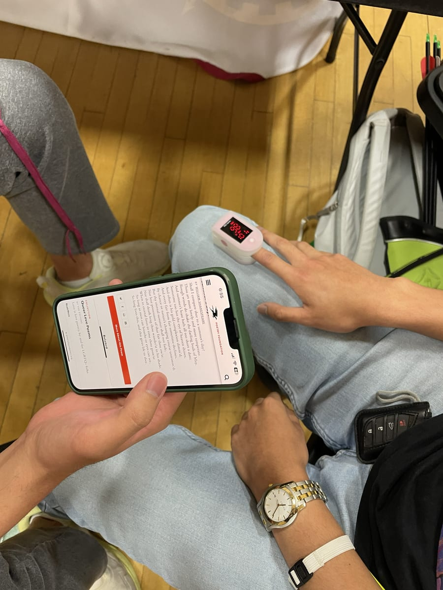
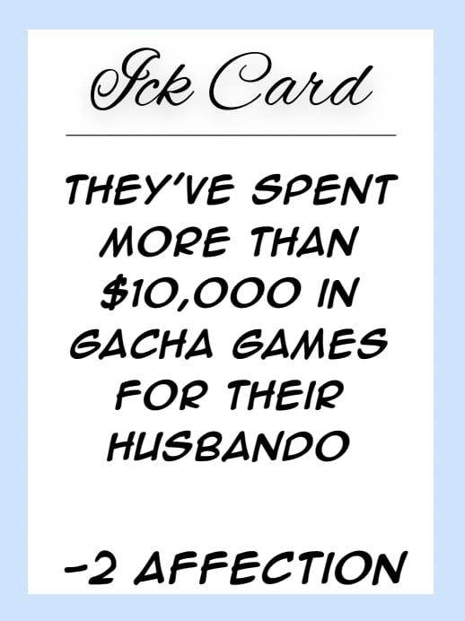
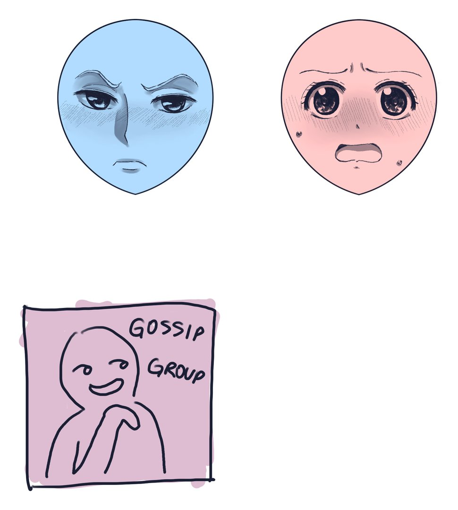
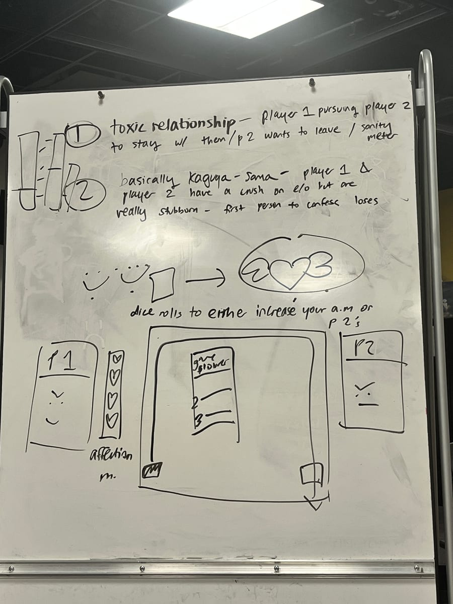
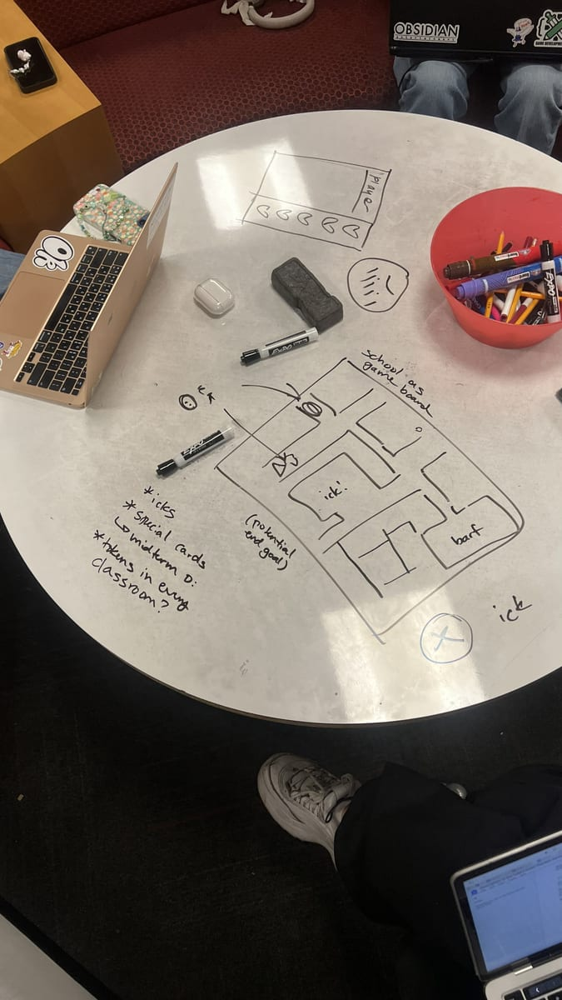
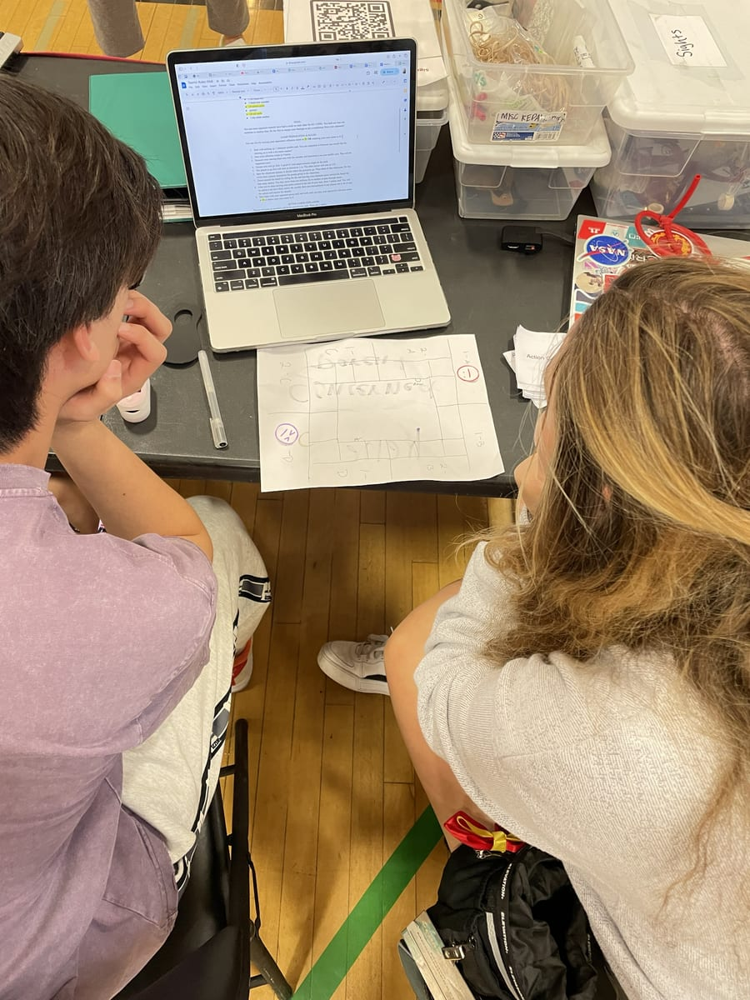
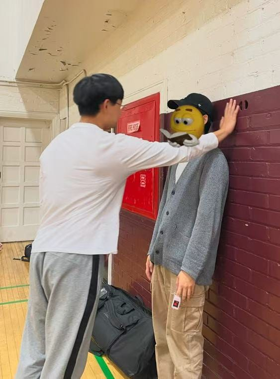

Yes, it's another romance board game. Can't explain why. Maybe our team just wanted to find love.

The project gave us three constraints: **PvP**, **press your luck**, and **rescue/escape**. Sounds like an adventure game, right? So that's what we tried first. We brainstormed for a while and somehow ended up recreating *Catan*. I guess that game just lives in everyone's head rent-free.

So we went back to romance, our comfort zone. The idea came from Walten Chan, our resident anime fan (shout out to him): *Kaguya-sama: Love is War*. Two students who are obviously into each other, but both way too stubborn to confess first. That's basically a PvP game already. The tricky part was fitting "escape" into a love story.

<Wide caption="The finished game: rules, board, spinner, heart rate monitor, cards and the box">
  
</Wide>

## The game

You and your opponent are each other's crush. I do think that's the perfect setup, because people really do act like opponents when they're dating. You both start with 5 hearts on your affection meter, and there are two ways to win:

- Get your crush's meter up to **10**. They can't take it anymore and confess.
- Get your own meter down to **0**. You're over them. Congrats, you escaped your feelings.

<Figure caption="The affection meter lives on your profile card: color in the hearts with a dry-erase marker">
  
</Figure>

On your turn, roll a d4 and walk around the school. Land on a hallway tile and you draw a **Rizz card**, which you have to act out on your crush. Stuff like: kabedon them (slam the wall, pin them against it), shyly hand them a homemade bento box, turn a Fortnite dance into a seductive one, or call them "pookie wookie bear" while complimenting their outfit.

<Wide caption="The final board: a Japanese high school, classrooms 1-A to 2-D around a courtyard">
  
</Wide>

Now the press-your-luck part. Your crush wears a **heart rate monitor**. You check their BPM, do the card, then check again. Nobody can really control their heart rate, so you're betting you can actually make their heart race. Three ways it can go:

1. **You do it and their heart rate jumps 10 BPM**: their meter goes up by the number on your tile (+1 or +2).
2. **You do it and nothing happens**: nothing happens. Good job for trying, but womp womp.
3. **You don't do it**: not every card is in everyone's comfort zone, and that's fine. But chickening out raises *your own* meter.

<Figure caption="The monitor. We checked it before and after every Rizz card">
  
</Figure>

The **gossip group** hangs out in the classrooms. Walk into their classroom and they spill some tea about your crush: you draw an **Ick card** and your own meter drops by the number on it. Then you spin the spinner and the gossip group moves to another classroom. That's how whoever's losing gets back in the game.

<Figure caption="One of the nicer Ick cards">
  
</Figure>

Other icks: they believe the earth is flat, they lie about their height, they bought an e-girl Discord Nitro. (I honestly don't remember how we came up with this stuff lmao xD)

If you both land on the same tile, it's a **pick-up line battle**. You take turns throwing your best, worst and corniest pick-up lines at each other, and whoever laughs first loses and gets +2 hearts.

Rosa drew all the art. Your pawn is either the panicking pink face or the "I'm totally not blushing" blue face. You also get a dry-erase profile card to draw yourself on.

<Figure caption="The player pawns and the gossip group">
  
</Figure>

## The iterations

### Ideation day: turning the constraints into mechanics

<Figure caption="Ideation day whiteboard">
  
</Figure>

So what do you escape in a love story? Your own feelings. That's why getting your own meter to 0 counts as a win. And press your luck became heart rate: you can't predict it, you can't control it, so every Rizz card is a gamble.

Our experience goal: *players will feel embarrassment and rivalry with the other player while acting out humiliating romantic scenarios.* Basically, make it cringe and make it competitive.

<Figure caption="The very first school map, drawn on a table">
  
</Figure>

In this first version, skipping a card dropped an "ick" token on your tile for your opponent to pick up, and failing a card raised your *own* meter. Remember that one, it comes back.

### First playtest: box breathing

<Figure caption="An early playtest">
  
</Figure>

The first time we played it ourselves:

- **15 BPM was the wrong threshold.** Your heart rate already bounces around on its own, so the number didn't really mean anything.
- **One guy cheated with box breathing.** He literally breathed his heart rate down on purpose. Respect.
- **Some cards were just dead.** "Recite Sonnet 18 like Shakespeare" did nothing. And nobody knew what a "TikTok body roll" was.
- **It was funny, not romantic.** People laughed way more than they blushed.

So we stopped fighting it and made it a comedy. We added the **gossip group and the spinner** so you'd actually have a reason to move around the map, and split the Rizz cards and Ick cards into two piles.

### Public playtests

We ran a bunch of playtests over the next week. Here's what we learned:

**The rewards were in the wrong order.** Remember, failing a card raised your own meter, so trying and failing was *worse* than not trying at all. We flipped it to *skip < try and fail < try and succeed*, and dropped the threshold to **10 BPM** because nobody was hitting 15. After that, the share of Rizz cards people actually acted out went from **25% to 61%**.

**Nothing happened when you met your crush on the same tile.** Two crushes bump into each other in the hallway and... nothing? Come on. So we added the pick-up line battle.

**Smaller numbers.** With a d6 the gossip group was way too easy to reach, so we switched to a **d4**. Playing to 20 hearts took forever, so we cut it to 10. Oh, and "Action card" became "**Rizz card**". Our playtesters came up with that one, we just stole it.

<Figure caption="A kabedon, performed live">
  
</Figure>

**Some people just didn't want to play.** Some playtesters weren't comfortable with the game at all, and that's totally fine. So now the rules open with a **content warning**: get consent from your opponent before you play. Honestly a good lesson for making games in general.

### The survey that blamed the hardware

We had people fill out a 1–5 survey after every round of playtests. By the last one, fun, visuals and drama were all sitting at 4.5–5. Only one score kept going down: "the heart rate monitor matched how I felt" dropped from **4.0 to 2.0**.

That wasn't the design, it was the hardware. We'd bought a $20 monitor off Amazon. It took forever to start up, didn't work with long nails (use your thumb), and by the final playtest it had *maybe* worked once. Anyone with an Apple Watch just used that instead.

### Final playtest

Our playtesters left some great reviews along the way: *"This is so federal. This is so crazy,"* and *"Makes me want to die."* At the final playtest someone played music off their phone during the Rizz cards, which made everything better.

It also showed us the game isn't for everyone. With people you don't know well, it's just awkward. With best friends and couples, it's hilarious. Some cards work for friends, and some really only work for couples. But in the right group it's a great icebreaker, not gonna lie.
