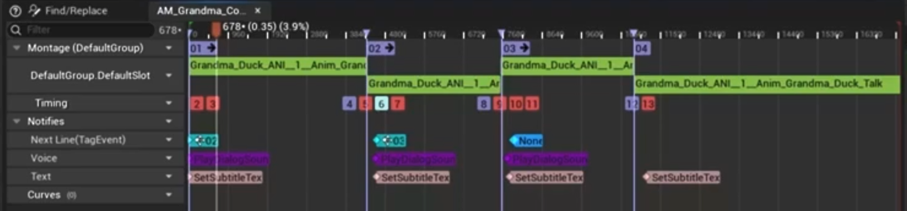
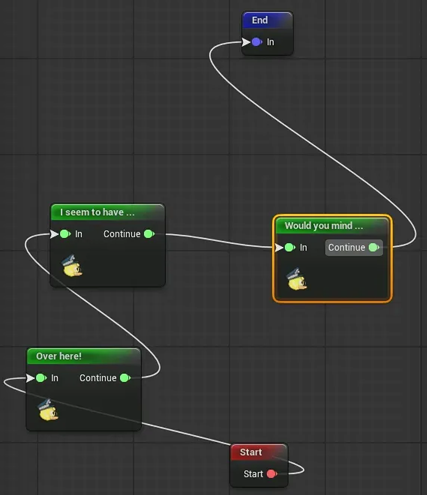
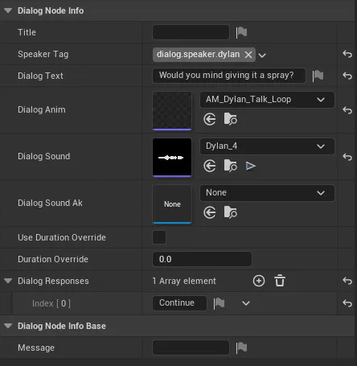
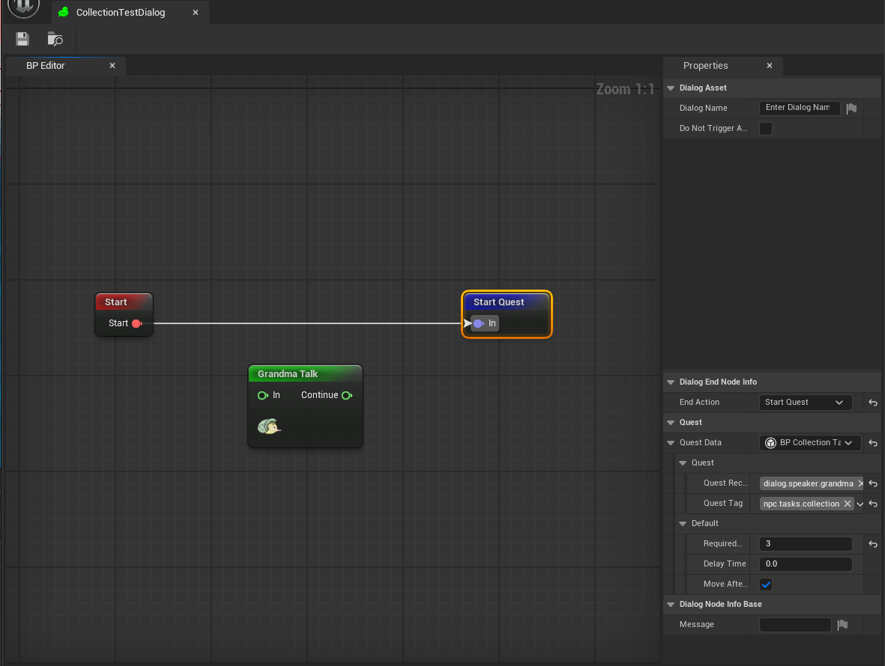
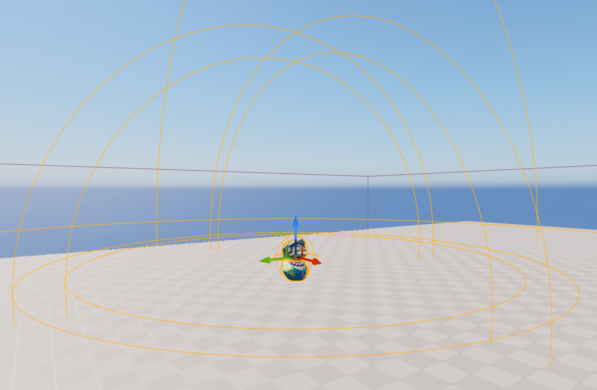
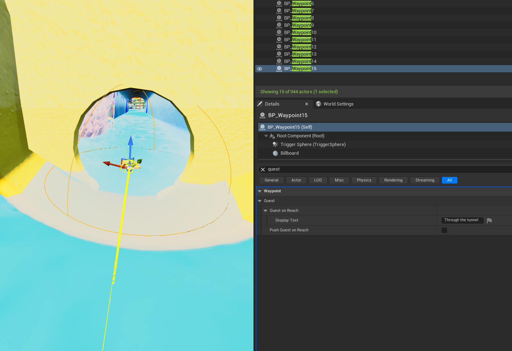
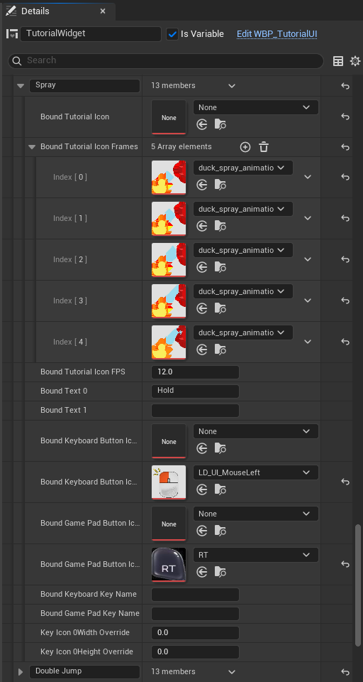
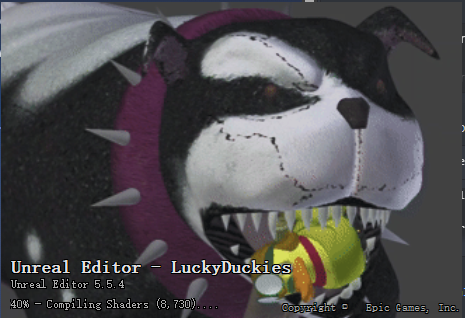
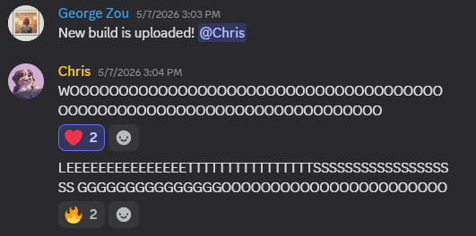

import QuestFlow from '../../../components/diagrams/QuestFlow.astro';
import talk from './talk.mp4';
import questTalk from './quest-talk.mp4';
import bubble from './bubble-v2.mp4';
import questMoveShow from './quest-move-show-v3.mp4';
import questMoveAnim from './quest-move-anim.mp4';
import charSelect from './char-select-v4.mp4';
import boatProgress from './boat-progress-v2.mp4';
import dozerHealth from './dozer-health-v2.mp4';
import tutorialSpray from './tutorial-spray.mp4';
import playerTracker from './player-tracker.mp4';

Before I start, I just want to say thanks to everyone on our team. This project couldn't have happened without any of you, and it's the best project I've ever been part of. I kind of miss all the late-night debugging, the system design meetings and the UI tweaking chats... I hope everyone reading this gets a chance to play the game. It's pretty fun, not perfect, but we tried our best. Enjoy!

*Lucky Duckies* is a cute, cozy co-op 3D game we made over a full year as a USC Games project, better known as AGP (Advanced Games Project). You and a friend play two rubber ducks and lead your ducklings home through a giant bathtub, with puzzles, bubbles and a scary dog chasing you along the way, either in local split-screen or online.

Check our trailer:
<Wide caption="The trailer">
  <YouTube id="Ege3Rsj1TKc" title="Lucky Duckies trailer" />
</Wide>

Feel free to download and have fun!
{/* Steam's official store widget. color-scheme: light matches the widget page, otherwise
    the browser paints a white backdrop behind it on this dark-scheme site */}
<iframe src="https://store.steampowered.com/widget/4506950/" width="646" height="190" style="border:0;max-width:100%;color-scheme:light" title="Lucky Duckies on Steam" loading="lazy"></iframe>

As a systems/UI engineer on the team, I built the **dialogue system** with Julian and did most of the game's **UI** with Jiawei, including the HUD, the tutorials, the quest tracker, character selection and the menus.

I'd like to share some highlights from that work without turning this into a 10,000-line tech blog. If you're interested, I'm happy to share more and chat!
## Dialogue

Due to our game features, the dialogue system could stay pretty lightweight. It had to play lines in order, keep the subtitles in sync with the voice and the animation, start gameplay (like a quest) when a conversation ends, and replicate to both players. We didn't need a big narrative tool for that, so Julian and I wrote our own.

### The first version

Our first version ran on the Gameplay Ability System (GAS). Each NPC had an ability that played one long animation montage, and every line of dialogue was a section of that montage. The lines themselves were rows in a data table:

```cpp title="DialogTableRow.h"
USTRUCT(BlueprintType)
struct FDialogTableRow : public FTableRowBase
{
    FName NextDialogRowName;            // which row plays next
    FGameplayTag SpeakerTag;            // who says it
    FText Text;                         // the subtitle
    TSoftObjectPtr<USoundBase> Sound;
    TSoftObjectPtr<UAnimMontage> AnimMontage;
    float Duration;
};
```

Anim notifies on the montage timeline sent the next line's tag, set the subtitle and played the voice, so the text always lined up with the animation.

<Wide caption="Grandma's first conversation montage. Sections 01 to 04 are the four lines; the notify tracks below send the next line's tag, play the voice and set the subtitle">
  
</Wide>

Skipping a line just jumped the montage to the next section:

```cpp title="GAP_ProvideDialog.cpp"
void UGAP_ProvideDialog::HandleDialogSkip(FGameplayEventData Payload)
{
    // Only the player who started the conversation can skip it
    if (Payload.Instigator != InteractingActor) return;
    if (NextDialogMontageSectionName == NAME_None) return;

    // Each line is a montage section, so skipping = jumping to the next one
    GetOwnerAnimInstance()->Montage_JumpToSection(NextDialogMontageSectionName, DialogMontage);
}
```

But we didn't want dialogue hard-coded or scattered across Blueprints. We wanted designers to write it on their own, so we rebuilt it as an Unreal plugin with a graph editor.

### A graph designers can edit

The plugin has two modules. The **editor** module gives designers a graph editor to build conversations right in Unreal, and the **runtime** module plays them, including network sync. Changing a line or a branch no longer needs a programmer.

To use it, a designer gives a character a **Dialoger Tag** (its identity, like Dylan or Grandma) and a `DialogAsset`. The graph has three kinds of nodes: Start, Dialog and End. A Dialog node is one line, with its text, animation, voice and duration, and an End node can carry quest data.

<Figure tall caption="Dylan's Level 1 conversation: Start, three lines from Dylan, then End">
  
</Figure>

The key design point is that **the node is graph structure, and the `NodeInfo` is content data**. The graph says where to go next, and the `NodeInfo` says what this line says, what it plays and when it ends. On save, the editor graph is synced into a runtime structure, so the game never runs on editor objects.

<Figure caption="The NodeInfo for one of Dylan's lines: speaker tag, text, animation, sound and duration">
  
</Figure>

### Starting a conversation

A conversation starts either from a trigger sphere in the level or from the player pressing interact on an NPC. Any character that implements `IDialogCharInterface` counts as a dialogue character, so the system doesn't care which NPC class it is. Both entry points end up in `ALDPlayerController::StartDialog`. It goes through the controller because, from the player's side, a conversation is a session: it involves UI, input, and who owns it in multiplayer.

### Running the graph

The core is `UDialogGISubsystem`, the state machine that runs the graph. `StartDialog` checks that the session, the controller and the asset are all valid, finds the Start node, and starts processing nodes one by one. The Dialog node is where the real work happens:

```cpp title="DialogGISubsystem.cpp"
void UDialogGISubsystem::ProcessDialogNode()
{
    // The NodeInfo is what the designer filled in for this line
    UDialogNodeInfo* NodeInfo = CurrentDialogNode->GetNodeInfo<UDialogNodeInfo>();
    if (!NodeInfo) return;

    // Find the character in the level whose Dialoger Tag matches this line's SpeakerTag
    IDialogCharInterface* Speaker = UDialogFunctionLibrary::GetDialogSpeakerI(this, NodeInfo->SpeakerTag);

    // Pack the line's performance data and let the speaker act it out
    FDialogActionData ActionData(*NodeInfo);
    if (Speaker)
    {
        Speaker->PerformDialogAction(ActionData);
    }

    // Meanwhile the player's UI shows the subtitle
    SetDialogText(NodeInfo);
}
```

**The subsystem owns the graph and the session, and the speaker owns the performance.** So each line runs on two paths: the character plays the animation and voice, and the player's UI shows the subtitle. They all start and end together, sharing one duration (the voice's length, or an override). Unlike the first version, the animation is just a talk loop now, so changing a line doesn't mean editing a montage.

<Figure caption="Dylan's boat-stuck conversation in game, the same graph as above. Top left: debug messages for each node">
  <Video src={talk} tall />
</Figure>

### Timing, and starting quests

After a line starts, the subsystem works out how long it lasts (the duration override, or the voice's length), picks the next node right away, and starts a timer. When the timer is up, it moves on to that node.

```cpp title="DialogGISubsystem.cpp"
void UDialogGISubsystem::ProcessCurrentNode()
{
    if (!CurrentDialogNode) { EndDialog(); return; }

    // Online: tell the other side which node we're on (more on this below)
    if (bReplicated) ReplicateCurrentNode();

    switch (CurrentDialogNode->NodeType)
    {
    case EDialogNodeType::Start:
        ProcessStartNode();
        AutoProcessNextNode();    // pick the next node, wait, then come back here
        break;
    case EDialogNodeType::Dialog:
        ProcessDialogNode();
        AutoProcessNextNode();
        break;
    case EDialogNodeType::End:
        ProcessEndNode();         // may start a quest, then closes the conversation
        break;
    }
}
```

End nodes can also carry **quest data**: who receives the quest, and which quest it is. This adds more variety to our gameplay. When the conversation ends, the subsystem finds the receiver by tag and calls its `HandleQuest` to start the quest. This is also where my quest system started.

<Wide caption="An End node set to Start Quest. The quest data names Grandma as the receiver, the quest tag, and the quest's own settings">
  
</Wide>

```cpp title="DialogGISubsystem.cpp"
void UDialogGISubsystem::ProcessEndNode()
{
    if (UDialogEndNodeInfo* NodeInfo = CurrentDialogNode->GetNodeInfo<UDialogEndNodeInfo>())
    {
        if (UQuestDataBase* QuestData = NodeInfo->QuestData)
        {
            // The quest goes to whoever has the receiver tag, found the same way as a speaker
            IDialogCharInterface* QuestReceiver = UDialogFunctionLibrary::GetDialogSpeakerI(GetGameInstance(), QuestData->QuestReceiverTag);
            if (QuestReceiver)
            {
                QuestReceiver->HandleQuest(QuestData);
            }
        }
    }
    EndDialog();
}
```

### Online

Online sync comes down to three steps: the server decides who can start, the players sync which node they're on, and each side rebuilds the performance locally.

**1. The server decides who starts.** The dialogue system is basically one big state machine, so only one conversation can run at a time, or they'd step on each other's nodes and subtitles. So a client can't just start one. It asks the server to lock the subsystem first, kind of like a mutex, and the server says no if something's already playing:

```cpp title="LDPlayerController.cpp"
void ALDPlayerController::StartDialog(UDialogAsset* DialogAsset)
{
    if (HasAuthority())
    {
        // The server can just start
        UDialogFunctionLibrary::StartDialog(this, DialogAsset);
    }
    else
    {
        // A client remembers the asset and asks the server for the lock first
        CachedDialogAsset = DialogAsset;
        Server_LockDialogSubsystem();
    }
}

void ALDPlayerController::Server_LockDialogSubsystem_Implementation()
{
    // TryLock fails if a conversation is running or a synced node is being handled
    Client_HandleDialogLockResult(UDialogGISubsystem::Get(this)->TryLock());
}
```

**2. Sync the node, not the performance.** We don't send the subtitle, the audio time or the montage progress. Every time the subsystem processes a node, only *which node* goes over the network, through a replicated property on the `PlayerState`:

```cpp title="LDPlayerState.cpp"
void ALDPlayerState::RequestDialogSync(UDialogGraphNodeRuntime* Node)
{
    if (HasAuthority())
    {
        // Server: set the replicated property, clients get OnRep
        CurrentDialogNode = Node;
    }
    else
    {
        // Client: send the node up to the server
        Server_SyncDialogNode(Node);
    }
}

void ALDPlayerState::OnRep_CurrentDialogNode()
{
    // Hand the node to the GameInstance, which the dialogue subsystem listens to
    SyncDialogNode_Internal(CurrentDialogNode);
}
```

**3. Rebuild it locally.** The other side doesn't restart the conversation. `ProcessNodeSimulated()` just runs the synced node, so the subtitle, animation, sound and even the End node's quest all play there from the same data. **We sync the state, not the playback timeline**, which is clearer and more stable than syncing the performance. In local split-screen there's no network, so the subtitle just goes to both screens.

<Wide xl caption="A split-screen conversation with Grandma. The subtitle shows on both halves, and the quest tracker is at the top">
  <Video src={questTalk} wide />
</Wide>

### The “...” bubble

When you walk up to an NPC, a “...” bubble shows up over their head, so you know you can talk to them. In split-screen each player should only see their own bubble, so every NPC has **two bubble widgets**, one for each player:

```cpp title="NPCSpeechBubbleComp.cpp"
void UNPCSpeechBubbleComp::SetupSpeechBubbles()
{
    // One widget component per player, set up in the NPC Blueprint
    SpeechBubbleP1 = SpeechBubbleInterface->GetPrimaryPCSpeechBubble();
    SpeechBubbleP2 = SpeechBubbleInterface->GetSecondaryPCSpeechBubble();

    ULDFunctionLibrary::GetPlayerControllers(this, PrimaryLDPC, SecondaryLDPC);
    if (PrimaryLDPC)
    {
        // Owned by player 1, so only player 1's half of the screen draws it
        SpeechBubbleP1->SetOwnerPlayer(PrimaryLDPC->GetLocalPlayer());
    }
    if (SecondaryLDPC)
    {
        SpeechBubbleP2->SetOwnerPlayer(SecondaryLDPC->GetLocalPlayer());
    }

    // Hide both bubbles while a conversation is playing
    DialogSubsystem->OnDialogStarted.AddUObject(this, &UNPCSpeechBubbleComp::OnDialogStarted);
    DialogSubsystem->OnDialogEnded.AddUObject(this, &UNPCSpeechBubbleComp::OnDialogEnded);
}
```

I first made the bubbles world-space widget components, because a 3D bubble floating in the bathtub looked really nice. But in world space, both players see the same bubble, so I couldn't show each player their own. I gave that up and switched them to screen space, with nicer UI art to make up for it.

Three spheres around the NPC handle showing the bubble, getting close enough to talk, and leaving. Getting close also makes the NPC your interact target. After a conversation, the bubbles come back for anyone still nearby.

<Figure caption="Grandma in the editor, with the spheres around her shown in orange">
  
</Figure>

<Figure caption="Walking up to Dylan: the “...” bubble turns into “Dustin, Darlene...” with the interact prompt, and goes back when you walk away">
  <Video src={bubble} tall />
</Figure>

## Quests

After dialogue built, our designer wanted the game to be more “suggestive” and clear, since some playtesters said they didn't know what the point of certain tasks was. That's where the quest system came in. On screen it's just one line at the top that tells you your current goal.

<Wide xl caption="In game: the quest at the top changes from “Lead Grandma Daphne…” to “Spray Dylan’s Boat” and back, then the “Duckies to Collect” panel drops in and pushes it down">
  <Video src={questMoveShow} wide />
</Wide>

A quick aside: the quest line moves out of the way. When a collection task starts, the HUD pushes the quest down under the collection panel. When the task is done, the panel hides itself after 5 seconds and the quest slides back up:

```cpp title="LDUIComponent.cpp"
void ULDUIComponent::HandleStartCollection(int32 RequiredCount)
{
    CollectionWidget->SetVisibility(ESlateVisibility::HitTestInvisible);
    CollectionWidget->InitializeCollection(RequiredCount);
    // Blueprint event: WBP_Quest plays Anim_CollectionShow forward (quest moves down)
    QuestWidget->OnCollectionVisibilityChanged(true);
}

void ULDUIComponent::HandleAutoHideCollection()   // 5 s after the task is complete
{
    CollectionWidget->HideUI();
    // Same animation played in reverse (quest moves back up)
    QuestWidget->OnCollectionVisibilityChanged(false);
}
```

<Figure caption="Anim_CollectionShow in the UMG editor: the quest moves 220 px down over 0.25 seconds">
  <Video src={questMoveAnim} />
</Figure>

### A stack of quests

A quest is just a line of text waiting to be popped off in order, so I simply made them a **stack** on the `GameState`. The newest quest goes on top, and it gets popped once it's done. So a side task can interrupt the main goal, and once you finish it, the main goal shows up again on its own.

```cpp title="LDGameState.cpp"
void ALDGameState::PushQuest(FLDQuestData NewQuest)
{
    QuestsStack.Push(NewQuest);
    OnQuestChanged.Broadcast(NewQuest);   // the HUD always shows the top
}

void ALDGameState::PopQuest()
{
    if (QuestsStack.IsEmpty()) return;
    QuestsStack.Pop();
    // Go back to the quest underneath, or an empty one (the HUD hides)
    OnQuestChanged.Broadcast(QuestsStack.IsEmpty() ? FLDQuestData() : QuestsStack.Top());
}
```

### Who gives you a quest

Quests come from a few places. The dialogue End node can carry quest data, so a conversation can hand you a quest when it ends. A waypoint can push one when the players or Grandma reach it, and level triggers can push or clear one when you walk through them. Puzzles clear theirs when you solve them.

<Wide caption="A waypoint at the tunnel. Its Quest on Reach is set to “Through the tunnel”, with a checkbox to turn the push on">
  
</Wide>

### Online

The stack is replicated on the `GameState`. The server pushes and pops, and clients rebuild the HUD in `OnRep`. The HUD widget doesn't know where quests come from. It just listens to `OnQuestChanged` and shows the top of the stack, or hides when it's empty:

```cpp title="LDGameState.cpp · Widget_Quest.cpp"
void ALDGameState::OnRep_QuestStack()
{
    // Clients: the stack just changed, show whatever is on top now
    OnQuestChanged.Broadcast(QuestsStack.IsEmpty() ? FLDQuestData() : QuestsStack.Top());
}

void UWidget_Quest::OnQuestChanged(const FLDQuestData& QuestData)
{
    if (QuestData.DisplayText.IsEmpty())
    {
        SetVisibility(ESlateVisibility::Hidden);
        return;
    }
    SetVisibility(ESlateVisibility::HitTestInvisible);
    Text_QuestTitle->SetText(QuestData.DisplayText);
}
```

<QuestFlow />

## UI

UI is a big part of our game, since it has to work with a lot of gameplay features.

Jiawei and I built our UI framework on CommonUI. Every screen sits on a stack picked by a gameplay tag (frontend, game menu, modal…), and opening a menu just means pushing a widget onto the right stack, loaded async so the game doesn't hitch:

```cpp title="FrontendUISubsystem.cpp"
// Load the widget class in the background, then push it onto the stack with this tag
UAssetManager::Get().GetStreamableManager().RequestAsyncLoad(InSoftWidgetClass.ToSoftObjectPath(),
    FStreamableDelegate::CreateLambda([=]()
    {
        UCommonActivatableWidgetContainerBase* Stack = CreatedPrimaryLayout->FindWidgetStackByTag(InWidgetStackTag);
        Stack->AddWidget<UWidget_ActivatableBase>(InSoftWidgetClass.Get());
    }));
```

So a confirm popup always goes on the modal stack and stays on top, even over the blurred pause menu.

On top of that framework, I built the screens players actually see and interact with, mostly in UMG.

### Character select

Character select works like picking teams in *NBA 2K*: Dustin on the left, Darlene on the right, and you push your box over with the stick. Two boxes in the same column stack, and when one leaves, the other slides up.

My first version used fixed UMG animations, one per move (middle to left, middle to right). Those broke as soon as two boxes shared a column and had to stack or slide up, so I switched to tweening in code. Each column is an array of boxes, so every box sits in a grid cell, and a move just eases both boxes to their new cells in `NativeTick`:

```cpp title="Widget_CharacterSelection.cpp"
void UWidget_CharacterSelection::StartAnimation(ESelectionBox SelectionBox, FIntVector2 CellCoord)
{
    // Grid cell -> pixels: 420 px per column, 130 px per row
    Entry.Start = Slot->GetPosition();
    Entry.End = OriginPos + FVector2D(CellCoord.X * HorizontalOffset, CellCoord.Y * VerticalOffset);
    Entry.ElapsedTime = 0;
    Entry.IsActive = true;
}

// NativeTick: 0.3 s ease-out toward the target cell
float t = FMath::Clamp(Entry.ElapsedTime / AnimDuration, 0.f, 1.f);
Slot->SetPosition(FMath::Lerp(Entry.Start, Entry.End, FMath::InterpEaseOut(0.f, 1.f, t, 2.f)));
```

The box also swaps its arrow and confirm icons between keyboard and controller, depending on what each player is holding.

<Wide xl caption="Character select at 1.5x: the boxes move between Dustin and Darlene, and stack when they end up in the same column">
  <Video src={charSelect} wide />
</Wide>

### Tutorial prompts

Here's how a prompt gets on screen. A designer drops a tutorial trigger (a sphere or capsule component) in the level and types a name on it, like "Spray". When a player walks in, the trigger tells that player's UI component to show "Spray", and when they walk out, to hide it. The UI component hands the name to the tutorial widget, which looks it up in its tutorial map.

Each entry in that map is everything one prompt needs: the action's icon (or a set of animation frames), a line of text, and separate keyboard and controller button icons. So a new tutorial is just a new trigger and a new map entry, no code.

Triggers can overlap, so the UI component counts them per name and only hides a prompt when its last trigger is gone. If another prompt is still active, that one shows up instead:

```cpp title="LDUIComponent.cpp"
void ULDUIComponent::AddToTutorialMap(const FString& UIName)
{
    if (UIName != CurrentUIName)
    {
        CurrentUIName = UIName;
        UpdateTutorialWidget(UIName);           // the widget looks the name up in its map
    }
    TutorialUIRegistration.FindOrAdd(UIName)++; // one more trigger for this prompt
}

void ULDUIComponent::RemoveFromTutorialMap(const FString& UIName)
{
    if (!TutorialUIRegistration.Contains(UIName)) return;
    if (--TutorialUIRegistration[UIName] > 0) return;   // still inside another trigger
    TutorialUIRegistration.Remove(UIName);
    if (UIName == CurrentUIName)
    {
        // Fall back to any prompt that's still active, or hide
        TArray<FString> Active;
        TutorialUIRegistration.GetKeys(Active);
        CurrentUIName = Active.IsEmpty() ? FString() : Active[0];
        UpdateTutorialWidget(CurrentUIName);
    }
}
```

The widget also listens for input changes, so the button icons swap the moment you pick up a controller, like the left mouse button turning into RT for Spray. 

One problem worth bringing up: the prompt has a fixed slot for each key, so WASD had to be a single wide image, and that width doesn't fit the controller's one stick icon. It's a typical case of a structure that stops matching what the game needs as development goes on. Next time I'd give each input type its own size and re-apply it on every input change.

<Figure tall caption="The Spray entry in the tutorial map: five animation frames at 12 FPS, “Hold”, and the mouse and RT icons">
  
</Figure>

For prompts that need to show an action, like spraying water, I didn't want a video or a material. The prompt just takes a list of images and flips through them on a timer:

```cpp title="Widget_Tutorial.cpp"
void UWidget_Tutorial::AdvanceTutorialIconFrame()
{
    // A tiny flipbook: next image every 1/FPS seconds, looping
    TutorialIconFrameIndex = (TutorialIconFrameIndex + 1) % TutorialIconFramesLoaded.Num();
    LazyImage_Tutorial->SetBrushFromTexture(TutorialIconFramesLoaded[TutorialIconFrameIndex]);
}
```

<Figure caption="Walking into the Spray trigger: the animated prompt pops up, and the button icon switches from RT to the left mouse button">
  <Video src={tutorialSpray} tall />
</Figure>

### Dozer's health bar

Dozer is the boss dog, and you fight him three times. His health bar just listens to his `OnBossHealthChanged` event, so it works the same in all three fights:

```cpp title="Widget_DozerHealthBar.cpp"
void UWidget_DozerHealthBar::OnHealthUpdated(float CurrentHealth, float MaxHealth)
{
    if (PB_Health && MaxHealth > 0.f)
    {
        PB_Health->SetPercent(CurrentHealth / MaxHealth);
    }
}
```

<Wide xl caption="A Dozer fight in split-screen, with his health bar and name across the top">
  <Video src={dozerHealth} wide />
</Wide>

### The boat bar that got cut

I also made a progress bar for the boat level. The boat follows a spline, so its progress is just how far along the spline it is, divided by the spline's length. A little knob rides along the end of the fill, and it only travels the bar's width minus its own, so it never sticks out past either end:

```cpp title="Widget_BoatProgress.cpp"
void UWidget_BoatProgress::UpdateKnobByFill(float P)
{
    const float BarWidth = BoatProgressBar->GetCachedGeometry().GetLocalSize().X;
    const float KnobWidth = image_Knob->GetCachedGeometry().GetLocalSize().X;
    // Slide the knob across the bar, keeping it inside both ends
    const float KnobX = P * (BarWidth - KnobWidth) + 4.0f;
    image_Knob->SetRenderTranslation(FVector2D(KnobX, 0.f));
}
```

It got cut right at the end, which happens. RIP boat bar.

<Wide xl caption="The boat level in the editor, before the bar was cut. The progress bar is at the top of each half">
  <Video src={boatProgress} wide />
</Wide>

## Other contributions

### Splash screen

Swapped the Unreal Editor splash screen for one with Dozer on it, so every time the team opened the project, the dog was there to greet them.

<Figure caption="The Unreal Editor splash screen for Lucky Duckies">
  
</Figure>

### Player tracker

In split-screen it's easy to lose your partner, so each player gets a marker at the edge of the screen that points toward the other duck when they're off screen.

<Figure caption="The marker at the edge of the screen points toward the other duck, and hides once they’re on screen">
  <Video src={playerTracker} tall />
</Figure>

### Debugs

Of course, as an engineer you're always debugging, and I dealt with bugs in pretty much every corner of this game, so I won't show them all off haha.

### The night before the final build

If I had to pick the most memorable part of this project, it's the night before the final build, when our director Chris found that if you clicked out of the game and back in, your next jump on the controller made the duck start spraying and it just wouldn't stop. 

We were racing the clock, so pretty much the whole engineering team stayed up chasing it. I found in the logs that the jump was getting eaten by the spray ability, and after 5–6 hours of digging together (with some help from Mr. Claude) we traced it back to CommonUI, which turns the A button into a fake left mouse click so a controller can press menu buttons, and of course our spray was on the left mouse button lol.

It only showed up in that one rare case, which is why it hid so well, but once we knew, the fix was simple: ignore those fake clicks whenever you're playing on a controller. It was like tearing the whole house apart looking for your glasses and then finding them on your head, and honestly I kind of loved it.

<Figure caption="The next afternoon... letsgoooooooooooo">
  
</Figure>

---

That's a whole year of work wrapped up, and it still feels short. Thanks again, Motherduckers, it was a blast building this with the team, and thank you for reading this far too!