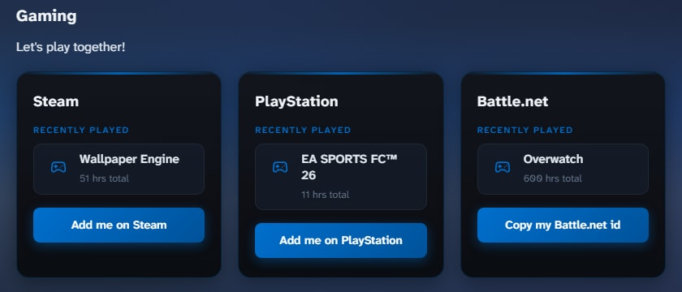
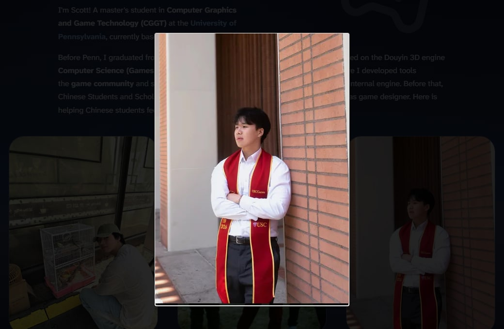
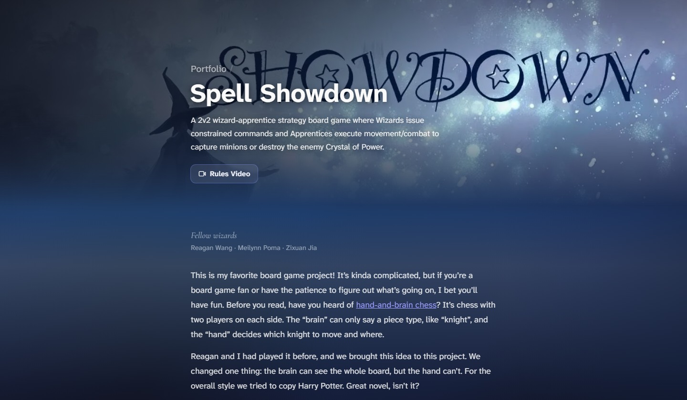
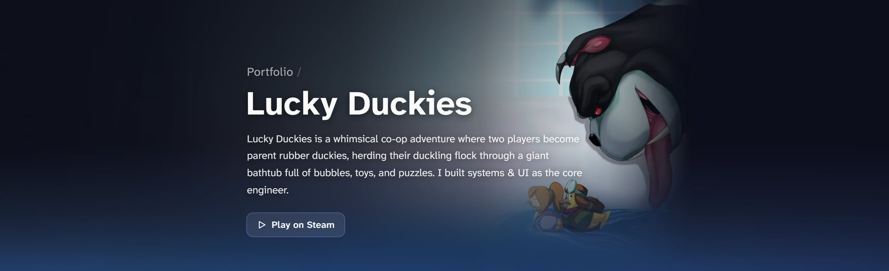
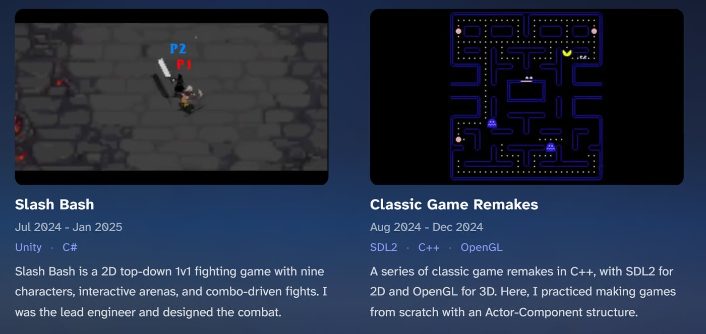
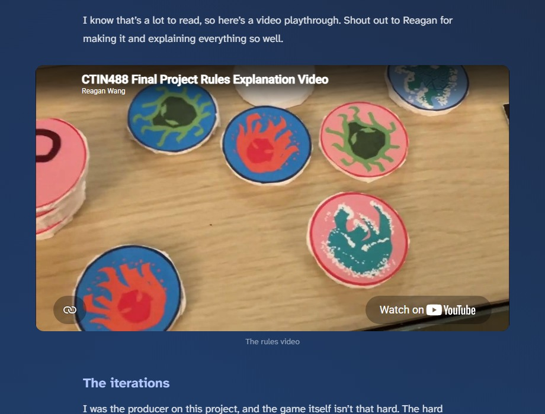
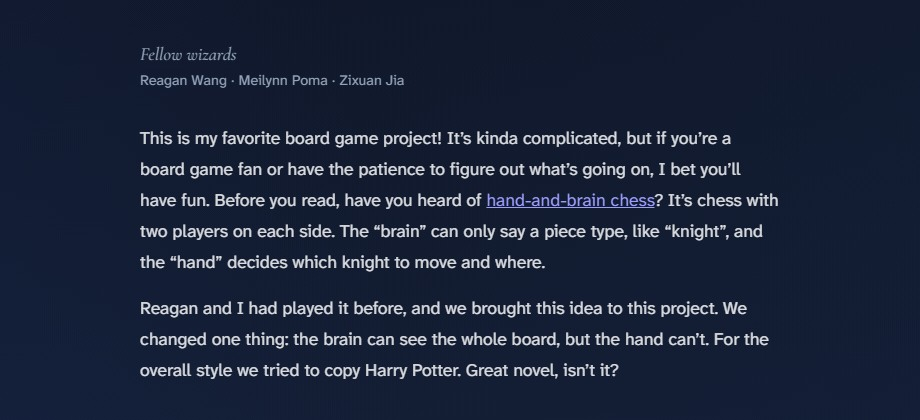
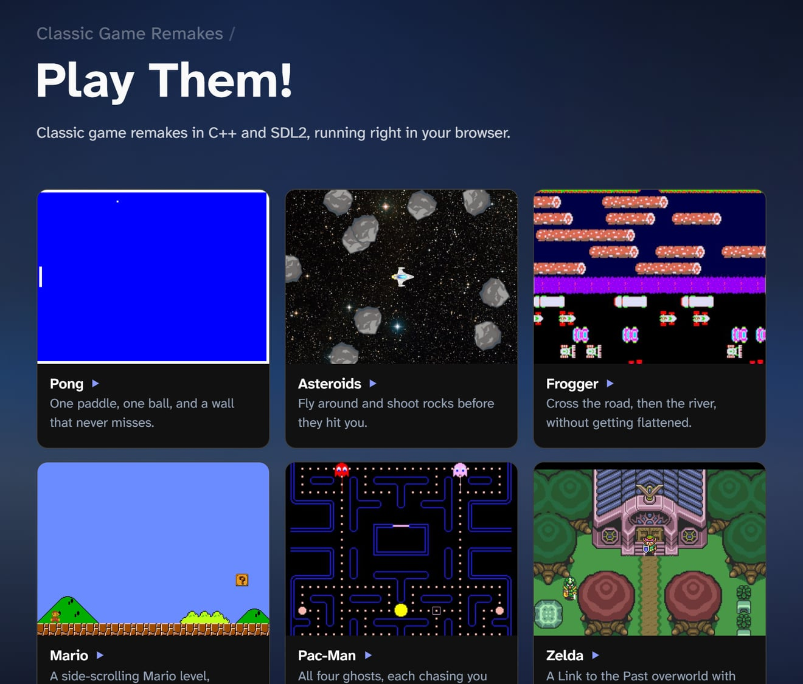

## Why

I wanted one place to show my projects properly. "Built a DX11 engine" on a resume doesn't say much, so here every project gets its own page with the details.

I do graphics and games and knew basically nothing about web dev, so I learned by building this, with docs and AI helping along the way. I went with Astro because it's light and easy to pick up: it outputs plain HTML, and JavaScript only shows up where I actually need it.

## What's here

- **Home**: who I am.
- **Portfolio**: one MDX file per project, with its images in the same folder.
- **Notes**: my Obsidian notes, synced over by a script.
- **Play**: my classic game remakes, running right in the browser.
- **About**: me, plus what I've been playing lately.

The portfolio cards and project pages read from the same MDX frontmatter, so a project's title, tags and description live in one place:

```astro title="src/pages/portfolio.astro"
const projects = new Map(
  (await getCollection('projects')).map((entry) => [entry.slug, entry])
);
```

Every page is prebuilt at deploy time. The one exception is the gaming widget.

## Recently played

The About page shows my latest Steam and PlayStation game. Mainly so I can find people to play with lol.



The site is static, but this data has to be live. So the API routes opt out of prerendering and run as Vercel serverless functions instead:

```ts title="src/pages/api/*.ts"
export const prerender = false; // runs per request, not at build time
```

**Steam** has an official API, so this one is simple. Ask for one game, and cache the answer for 5 minutes so Steam isn't hit on every page view:

```ts title="src/pages/api/steam-recent.ts"
const url = `.../GetRecentlyPlayedGames/v1/?key=${key}&steamid=${id}&count=1`;
return new Response(JSON.stringify({ games: list }), {
  headers: { 'Cache-Control': 'public, max-age=300' },
});
```

**PlayStation** has no public API. I use `psn-api`, which goes through Sony's own login flow: an NPSSO cookie becomes an access code, and the access code becomes an access token plus a refresh token. Doing that whole chain on every request would be slow, so the tokens live in a module-level variable. A serverless instance stays warm for a while between requests, and during that time every visitor reuses the same token:

```ts title="src/pages/api/psn-recent.ts"
let auth = null; // survives between requests while the instance is warm

async function getAccessToken(npsso) {
  const now = Date.now();
  if (auth && now < auth.expiresAt) return auth.accessToken;   // still valid

  const tokens = auth && now < auth.refreshExpiresAt
    ? await exchangeRefreshTokenForAuthTokens(auth.refreshToken) // cheap refresh
    : await exchangeAccessCodeForAuthTokens(
        await exchangeNpssoForAccessCode(npsso));                // full login
  // ...store tokens, expiring 60s early to be safe
}
```

If anything fails, `auth` is reset so the next request starts clean. Sony also returns playtime as an ISO duration like `PT228H56M33S`, so a small regex turns that into hours. The weak spot is the NPSSO cookie itself: it dies every ~2 months, and then I have to log in and paste a new one by hand.

On the page, one function handles both platforms. Each platform just passes its endpoint and a small mapper that turns its response into the same shape (`name`, `hours`, `url`), so the rendering code doesn't care where the data came from.

**Battle.net** has no API, so that panel is hard-coded. Yes, the 600 hours of Overwatch are real.

## Click to zoom

Click an image to see it bigger.



No library here. It's the browser's built-in `<dialog>` element. `showModal()` puts it in the top layer above everything, dims the page with `::backdrop`, and fires a `cancel` event on Esc, so most of the work is already done:

```js title="src/layouts/Layout.astro"
function openZoom(src) {
  dialogImg.src = src;
  document.body.style.overflow = 'hidden'; // stop the page scrolling behind it
  dialog.showModal();
}

dialog.addEventListener('cancel', closeZoom); // Esc
dialog.addEventListener('click', closeZoom);  // click anywhere
```

A few details:

- It opens `img.currentSrc`, the file the browser already loaded, so zooming never downloads anything new. The downside: the zoom is only as sharp as that file. The About photos are loaded at 400px, so they don't get much bigger. That's on my to-do list.
- Card thumbnails and banners are excluded by selector, and any other image can opt out with `data-no-zoom`.
- It's desktop only. It checks `matchMedia('(pointer: coarse)')` and skips touch screens, since pinch zoom already does this job better.

## One width to line things up

Pages have different column widths: text is 40–50rem, notes are wider, and banners are full width. I wanted them to line up and scale together instead of each page doing its own math. So there's one variable:

```css title="Layout.astro · portfolio/[slug].astro"
:root { --fluid-width: calc(0.65 * (100vw - 3.5rem)); }
@media (max-width: 768px) { :root { --fluid-width: 100%; } }

.project-page { width: min(40rem, var(--fluid-width)); }
```

Every column is `min(its max, var(--fluid-width))`. On desktop it's 65% of the window up to its cap. On phones it's full width.

The footer was trickier. It should be as wide as the page's **text**, not its widest image, or it looks off on every page. So each page tells the layout its text width, and the footer uses that:

```astro title="src/pages/portfolio/[slug].astro"
<Layout textWidth="40rem">  <!-- footer gets --footer-width: 40rem -->
```

The project banners (like the one at the top of this page) break out to `100vw`. The problem is that `100vw` includes the scrollbar, so the page grows a horizontal scrollbar. `overflow-x: hidden` would fix that but also breaks `position: sticky` (the Notes sidebar uses it). `overflow-x: clip` cuts off the extra few pixels without creating a scroll container, so sticky still works.

## Project pages

Once I started writing the board game pages, a plain column of text and images got boring fast. So the project pages got a bunch of upgrades.

### The banner

The cover image runs across the whole window, Steam style, with the title and description sitting on the left.

<Wide caption="The banner on the Spell Showdown page">
  
</Wide>

The tricky part is wide screens. A 16:9 cover stretched across an ultrawide monitor looks blurry and gets cropped badly. So the banner actually draws the image twice. The back copy fills the whole width, blurred and darkened. The sharp copy on top stops at 100rem and fades out at its edges, so on a big screen you get a sharp picture in the middle and a soft glow on the sides:

```css title="src/pages/portfolio/[slug].astro"
.banner-fill  { width: 100%; filter: blur(40px) brightness(0.6); transform: scale(1.15); }
.banner-sharp { width: min(100%, 100rem); left: 50%; transform: translateX(-50%); }
```

The `scale(1.15)` is there because blur pulls in transparent pixels at the edges, and scaling it up hides that. On top of both there's a dark gradient from the left so the white title is always readable, and a mask fades the bottom into the page background.

Not every cover works as a banner though. The Lucky Duckies key art is tall, so I added three frontmatter options: `cardImage` lets the card use a different picture, `bannerPosition` moves the crop, and `bannerBlur: false` drops the blurred copy and just goes dark on the sides. For Lucky Duckies the art sits on the right and fades into the page, so the title gets the left side to itself.

<Wide caption="The Lucky Duckies banner">
  
</Wide>

### Videos on the cards

A cover image is fine, but a few seconds of gameplay says more. So a card can set `cardVideo`, a small muted loop (640x360, about 1 MB) that plays instead of the image. The image becomes its poster, so nothing looks empty while it loads. With ten cards on one page, I didn't want them all playing at once, so each one only plays while it's on screen:

```js title="src/pages/portfolio.astro"
new IntersectionObserver((entries) => {
  entries.forEach(({ target: video, isIntersecting }) => {
    isIntersecting ? video.play() : video.pause();
  });
}, { threshold: 0.3 });
```

If you have reduced motion turned on, they don't play at all. This page's card is one too: it's the cover up there, slowly panning.

<Wide caption="Cards with video loops on the Portfolio page">
  
</Wide>

### MDX components

Markdown images can't do much: no caption, and they're always as wide as the text. So I made a few small components that every project page gets automatically, with no import:

- `<Figure caption="...">` adds a caption. Alt text is invisible, so this is the only way to actually say something under a picture.
- `<Wide>` lets an image break out of the 40rem text column to 50rem, for photos that need the space.
- `<YouTube id="...">` embeds a video.
- `<Video>` is for clips I'd normally use a GIF for. It's an mp4 that plays muted on a loop, so it looks the same, but way smaller: one 47 MB GIF came out at 3 MB. It also only plays while you can see it.

The YouTube one is just an iframe, but a few details matter. It uses `youtube-nocookie.com`, so YouTube doesn't set cookies until you press play. `loading="lazy"` means the player only loads when you scroll near it, which matters because a YouTube embed is way heavier than the rest of the page. And `aspect-ratio: 16 / 9` keeps the box the right shape at any width:

```astro title="spell-showdown/index.mdx"
<Wide caption="The rules video">
  <YouTube id="KR1s1_OIhdY" title="Spell Showdown rules video" />
</Wide>
```

<Wide caption="The Spell Showdown rules video, embedded in the page">
  
</Wide>

### Buttons and credits

Links like Print & Play, GitHub or a video go in the frontmatter, and show up as buttons under the banner description:

```yaml title="spell-showdown/index.mdx"
links:
  - { label: 'Print & Play', icon: 'download', url: 'https://drive.google.com/...' }
team: ['Reagan Wang', 'Meilynn Poma', 'Zixuan Jia']
teamLabel: 'Fellow wizards'
```

`team` is for my teammates. Most of these were team projects, and I wanted to thank them somewhere visible, kind of like movie credits, but at the start instead of the end. Each project gets its own label: "Fellow wizards" for Spell Showdown, "Fellow hopeless romantics" for Love Panic. The label uses Cormorant Garamond in italic, and that font is imported only on project pages, so other pages don't download it.

<Figure caption="The credits at the top of the Spell Showdown page">
  
</Figure>

### Backwards quotes

One bug I didn't see coming: some quotes on the page came out backwards. Markdown turns straight quotes `"` into curly ones, “ and ”, and it decides left or right by looking at the characters around them. That works fine for words. But the board game pages talk about “?” markers a lot, and with only a question mark inside, it guessed wrong and gave me ”?“. The fix was just typing the curly quotes myself in those spots, so there's nothing left to guess.

## Playing in the browser

My ITP 380 games are C++ and SDL2, so I compiled them to WebAssembly with Emscripten, and now you can play all nine of them on the [Play Them!](/play) page.

<Wide caption="The Play Them! page">
  
</Wide>

Nothing downloads until you press Play. Portal is about 28 MB, and browsers need a click before they allow sound or mouse lock anyway. A couple of things I ran into:

- Emscripten looks for the game's `.data` file next to the page, not next to the game, so nothing loaded. `locateFile` points it at the game's folder:

```js title="src/pages/play/[game].astro"
window.Module = {
  canvas: canvas,
  locateFile: (file) => `/play/${slug}/${file}`, // .wasm and .data live with the game
};
```

- The games are loud, and the C++ code has no volume setting. So I patched `AudioNode.connect`: anything that connects to the speakers goes through one gain node at 0.16 first, which sounds like about 40%.
- The C++ games don't reset themselves after a game over, so the Restart button just reloads the page lol.

## Font flash

Pages used to load in a system font and then jump to the real one. The two fonts have different widths, so the whole layout shifted, like the page zoomed out for a split second.

The cause was `font-display: swap`: show a fallback right away, then swap when the real font arrives. I switched to `block`, which tells the browser to wait for the font instead. I also stopped using the package's CSS and wrote the `@font-face` myself, importing the font file with Vite's `?url` so it gets bundled with a hashed filename like every other asset:

```astro title="src/layouts/Layout.astro"
import atkinsonLatin from '@fontsource-variable/atkinson-hyperlegible-next/files/atkinson-hyperlegible-next-latin-wght-normal.woff2?url';
```

```css title="src/layouts/Layout.astro"
@font-face {
  font-family: 'Atkinson Hyperlegible Next Variable';
  font-display: block;      /* wait, don't swap */
  font-weight: 200 800;     /* variable font: one file, every weight */
  src: url(...) format('woff2-variations');
  unicode-range: U+0000-00FF, ...; /* only download when these characters appear */
}
```

The trade-off: on a slow connection, text stays invisible for a moment (browsers cap it at about 3 seconds). It's worth it here because the font is small. It's split by `unicode-range` into a ~34 KB Latin file and a ~19 KB extended file, and the second one only downloads if a page actually uses those characters.

## Home page background

The home page background is a montage of my projects, but the video itself is never shown. It's a hidden `<video>` that gets uploaded to WebGL2 as a texture every frame. The screen is a grid of cells (about 20,000 on a 1080p screen), each one drawn as a single point, so the whole grid is one draw call. Each cell samples the video at its spot, gets cut down to one of 8 brightness levels, and picks its color from a palette built from the site's accent color. So whatever the clip looks like, it comes out as pixels in the site's colors.

Two details I like. Clips are very different in brightness (Asteroids is mostly black, Portal is mostly white), so each cell subtracts the frame's average brightness first. The average comes for free from the 1×1 mipmap level, so every clip lands at the same exposure. And when the clip changes, a noise value decides which cells flip first, so the new clip sweeps in patch by patch instead of all at once.

```glsl title="src/components/PixelVideoBackground.astro"
float order = fbm(cuv * vec2(uGrid.x / uGrid.y, 1.0) * 2.2 + uSeed) * 0.9 + 0.5; // when this cell flips
float local = clamp((uTrans - order * 0.65) / 0.35, 0.0, 1.0);                    // this cell's own progress

float lB = dot(textureLod(uLive, vuv, uLod).rgb, LUMA);         // brightness here
float aB = dot(textureLod(uLive, vec2(0.5), 12.0).rgb, LUMA);   // whole-frame average (smallest mipmap)
```

Your mouse leaves a short trail of brighter cells, and the "Tune background" button in the corner opens the sliders I used to pick the defaults. With reduced motion on, or without WebGL2, you just get a static gradient and the video never downloads.

## Color

Honestly the hardest part. Code at least throws errors. Color just looks wrong and doesn't tell you why. I tried a lot of combos (coral was a disaster) and landed on periwinkle, `#8b9cff`. Links, tags and hover states all read from one `--accent` variable, so the next time I change my mind it's a one-line fix.

---

This site is never really done. Will keep updating it as I go...
