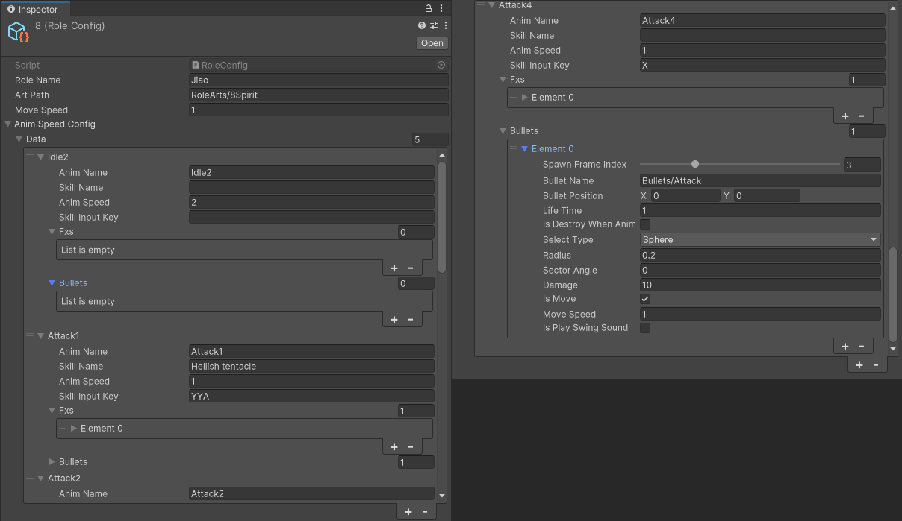
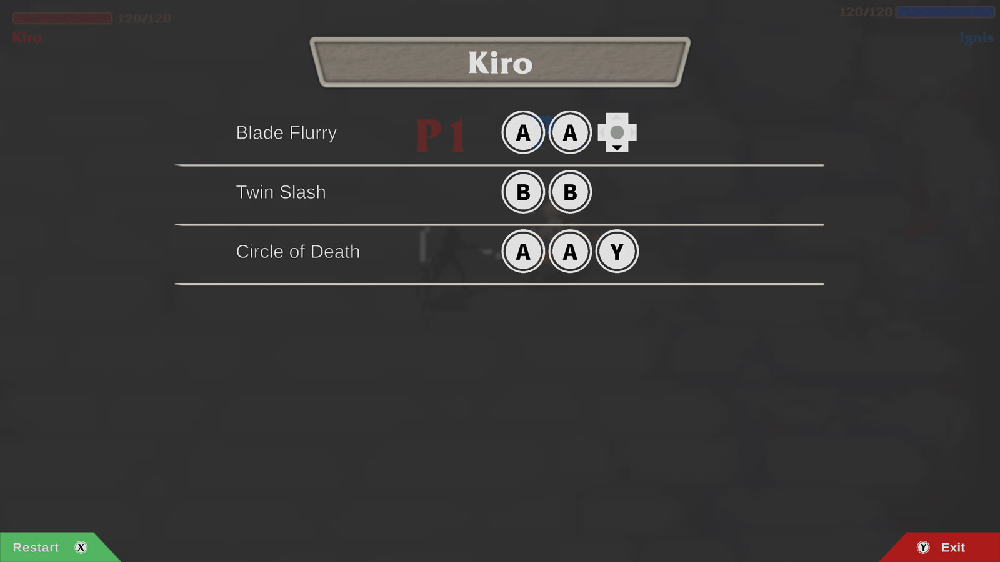
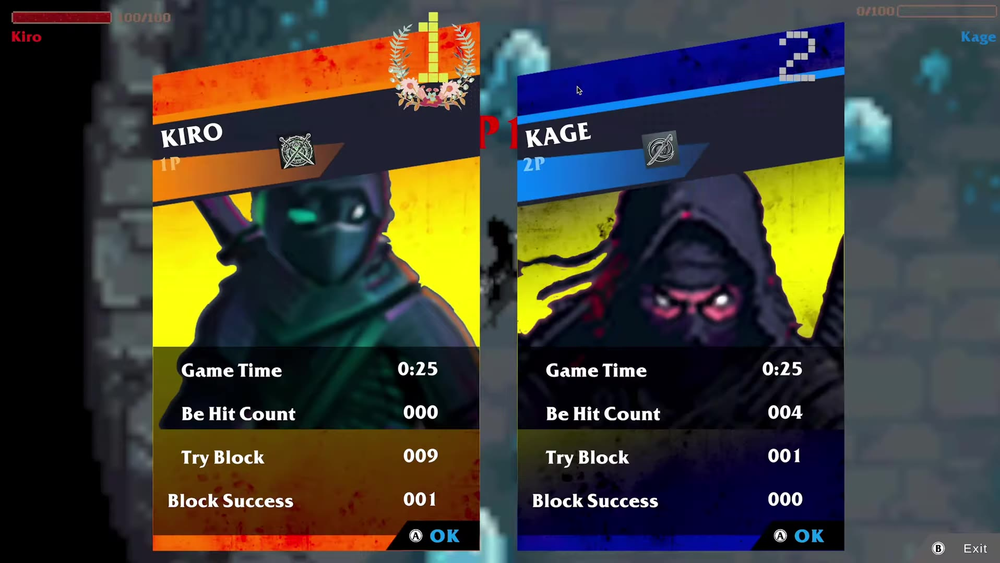
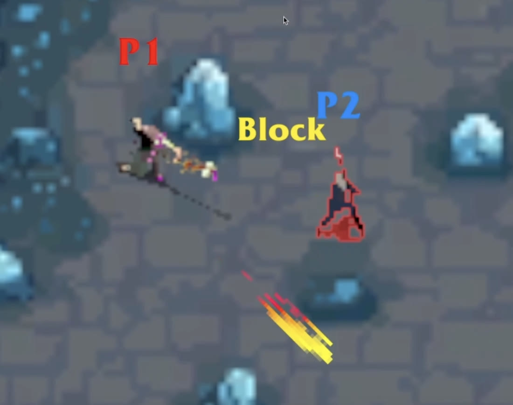

import debugGrid from './debug-grid.mp4';
import tyrThrow from './tyr-throw.mp4';
import hitbox from './hitbox.mp4';
import camera from './camera.mp4';
import burn from './burn.mp4';
import iceWall from './ice-wall.mp4';

I'm a huge fighting game fan (*UFC*, *Mortal Kombat*), and there aren't many 2D ones you can play on the couch with a friend. So we made *Slash Bash*, a local 1v1 fighter with **nine characters**, **three interactive arenas**, and skills you pull off with **short button combos**.

It was a USC Games × Berklee project. Nelson and I built the game, Liam from Berklee made the music, and my friend Yogi helped us through some core problems. I did most of the engineering and designed the combat, so if a character feels broken, you know who to blame lol. 

It's out on *itch* for Windows and Mac.

<Wide caption="The trailer">
  <YouTube id="b8XTMpA56pw" title="Slash Bash trailer" />
</Wide>

## Skills are just data

We kept changing the damage, the range, the timing of hits, and sometimes a whole move. That's 36 moves across nine characters, and every time the team came up with a new number, I didn't want to go back into the code for it. So I turned every skill into **data**.

Each character has a `RoleConfig`, which is a ScriptableObject with one entry per animation. An entry has the skill name, the combo, and a list of what I called "bullets." A bullet isn't really a projectile, it's just a hitbox plus a few settings.

```csharp
[System.Serializable]
public class BulletConfig
{
    [Range(-1, 14)]
    public int spawnFrameIndex;      // which animation frame it shows up on
    public Vector2 bulletPosition;   // offset, relative to where the character faces
    public float lifeTime = 1.0f;
    public BulletSelectType selectType;  // Sphere or Sector
    public float radius = 1.0f;
    public float sectorAngle = 0f;
    public float damage = 1;
    public bool isMove = false;
    public float moveSpeed = 1.0f;
}
```

When an attack plays, each bullet spawns on the frame it's set to, facing the same direction as the character. So if the sword comes down on frame 8 in the art, I put the hitbox on frame 8 too, and you only get hit when it actually looks like you got hit.

<Figure caption="The training range with gizmos on. The red circle is the hitbox">
  <Video src={hitbox} />
</Figure>

The bullet itself is **invisible**. Every frame it looks for players inside its circle with `OverlapCircleAll` (sectors also check the angle), and it keeps track of who it already hit so nobody gets hit twice by the same swing. The visuals live in a separate `fxs` list in the same entry. Tyr's Knife Throwing, for example, is an invisible hitbox and an arrow effect flying side by side at the same speed. The whole game only has **one bullet prefab**, and it's an empty GameObject with the Bullet script on it.

<Figure caption="Tyr's Knife Throwing">
  <Video src={tyrThrow} />
</Figure>

<Wide caption="Jiao's RoleConfig. Left: one entry per animation, with the skill name and combo. Right: one bullet opened up">
  
</Wide>

The art is set up the same way. Each character runs a small state machine, built on YogiGameCore, a utility library Yogi shared with me. Every state loads its sprite sheet by its own class name, so the `Attack2` state just loads `RoleArts/<character>/Attack2`. I didn't use Unity's Animator at all, and adding a move only takes a new sheet and a new config entry. Both players also use the **same character prefab**, and it only turns into Kiro or Ruun once the fight starts and it loads that character's config.

The pause menu reads the same config, too. It takes combo strings like `"BBA"` and shows them as button icons, so whenever we changed a combo, I didn't have to touch the pause menu.

<Figure caption="Kiro's pause menu">
  
</Figure>

## From controller to combo

Each controller gets its own `PlayerInput`, and my `InputController` turns every button press into a symbol. X, Y, A and B become `'X' 'Y' 'A' 'B'`, and the right stick becomes arrows. The stick needed one extra check, because holding it keeps sending the same direction, and the game would read that as →→→→. So it only sends a direction when the direction *changes*.

```csharp
if (inputDirection != prevInputDirection)
{
    if (inputDirection != '_')
        currentControlRole.InputSkillOrder(inputDirection);
    prevInputDirection = inputDirection;
}
```

**Every skill is a string**, like `"BBA"` for Kage's Phantom Smash, and each one has its own little matcher that remembers how far along you are. If your next button matches, it moves forward, and if it doesn't, it starts over. It also starts over if you wait more than **0.5 seconds** between presses. That number mattered more than I expected, because a shorter window makes every combo harder to pull off.

```csharp
// Called once per button press, for every skill the character has
public bool HandleInput(char inputChar)
{
    // Is this the button this skill expects next?
    if (inputChar == skillStr[currentMatchIndex])
    {
        currentMatchIndex++;   // move one step forward
        timer = 0;             // restart the 0.5s window

        // Matched the whole string: cast the skill and reset
        if (currentMatchIndex >= skillStr.Length)
        {
            OnCastSkillSuccess?.Invoke();
            currentMatchIndex = 0;
            return true;       // tells the controller to stop checking other skills
        }
        return false;
    }

    Clear();   // wrong button: back to the start
    return false;
}
```

Here's every combo in the game. X is the basic attack, and ×2 means the skill hits twice.

<Wide>

| Character | X | Skill 1 | Skill 2 | Skill 3 |
|---|---|---|---|---|
| Kage | 10 | Blade Strike `AA` 20 | Phantom Smash `BBA` 18×2 | Shadow Tempest `→BB` 35×2 |
| Sylva | 20 | Vine Lash `YY` 25 | Thorn Aim `BAA` 35 | Nature's Wrath `A→→` 55 |
| Ignis | 10 | Molten Cleave `AA` 20 | Flame Slash `YYB` 30 | God Cataclysm `BB↓` 50 |
| Shade | 20 | Quick Shoot `AA` 15+5 | Shadow Trap `YBB` 30 | Death's Cross `↑↑↓` 50 |
| Ruun | 10 | Storm Shock `BB` 35 | Lightning Field `AAB` 35 | Tornado Overload `YBY` 50 |
| Tyr | 20 | Knife Throwing `→→` 25 | Avalanche Strike `B←` 30 | Piercing Chaos `B→→` 40 |
| Kiro | 20 | Twin Slash `BB` 25 | Circle of Death `AAY` 35 | Blade Flurry `AA↓` 35×2 |
| Jiao | 10 | Soul Swipe `BB` 30 | Eternal Inferno `YBA` 30 | Hellish Tentacle `YYA` 35 |
| Garrick | 20 | Shield Bash `←←` 30 | Titan's Smash `A↓` 30 | Unyielding Rampage `ABY` 50 |

</Wide>

I also wrote NUnit tests for the matcher. One of them has two skills where one is the start of the other, `"ABC↑"` and `"ABC↑↑"`, and that case **doesn't work**. Once `"ABC↑"` fires, the loop stops, so `"ABC↑↑"` never sees that last ↑. None of the characters ended up with combos like that, so it never happens in a real match.

## Iteration

After one playtest, the biggest complaint was that once you got hit, you were pretty much dead. The other player could chain attacks faster than you could get your block up, so you just got cut down one hit at a time. Some of the big area attacks also hit way too hard and could be spammed. On top of that, we wanted each fight to last around 40 seconds to a minute.

To check whether our changes were working, the end screen shows the match time, how many times each player got hit, how many times they tried to block, and how many of those blocks worked. Those last two together give you a **block success rate**.

<Figure caption="The end screen. Kiro tried to block 9 times and landed 1">
  
</Figure>

The stats code doesn't touch the fighting code. A character just fires an event when it gets hit, starts a block, blocks something or dies, and `BattleManager` listens for those.

```csharp
role.OnBeHit += () => info.beHitCount++;
role.OnTryBlock += () => info.tryToBlockCount++;
role.OnBlockSuccess += () => info.blockSuccessCount++;
role.OnDie += () => info.isWinner = false;
```

Then we rebalanced. Skills went from single buttons to combos, which already makes them harder to spam. A blocked hit still does 3 damage now, HP went from 100 to 120, and all nine characters got new damage numbers. Since the skills were data, all of that was edits to nine asset files, and I didn't have to change any code.

We also noticed people don't look at the health bars in the middle of a fight, so now when you block, "Block" pops up over your character and you get an outline.

<Figure caption="P2 blocks: red outline, and &quot;Block&quot; pops up">
  
</Figure>

Players also said the characters looked tiny on a 2K screen, so the camera zooms in when the two players get close.

<Figure caption="The camera zooms in as the players close in, and pulls back out when they split">
  <Video src={camera} />
</Figure>

## A scene just for checking art

I also made a debug scene just for myself. It plays every character in every animation at the same time, **9 rows by 8 columns**. Whenever I swapped art or edited a config, I could open it and see right away if a sheet was missing frames or facing the wrong way.

<Figure caption="All nine characters, every animation at once">
  <Video src={debugGrid} />
</Figure>

## Other highlights

The fire arena has six burning traps. When you step on one, you get a `BurningBuff` component that does 5 damage right away and then 5 more every second for 2 seconds. If you step back in while you're still burning, it just resets the timer instead of adding a second buff.

```csharp
private void OnTriggerEnter2D(Collider2D collision)
{
    if (collision.TryGetComponent<Role>(out var role))
    {
        if (role.TryGetComponent<BurningBuff>(out var buff))
            buff.ResetLifeTimer();
        else
            role.AddComponent<BurningBuff>();
    }
}
```

<Figure caption="Walking into a fire trap. Each 5 is one burn tick">
  <Video src={burn} />
</Figure>

The crystals in the ice arena are on the Block layer. Movement does a raycast against that layer before every step, so you can't walk through them.

<Figure caption="Walking into an ice crystal">
  <Video src={iceWall} />
</Figure>

When someone dies, the camera lowers the loser's weight in the target group down to zero, so it slowly moves in on the winner before the end screen shows up.

```csharp
while (animTime > 0)
{
    animTime -= Time.fixedDeltaTime;
    for (int i = 0; i < group.m_Targets.Length; i++)
    {
        if (i == index)
            continue;
        CinemachineTargetGroup.Target target = group.m_Targets[i];
        target.weight -= Time.deltaTime;
        group.m_Targets[i] = target;
    }
    await UniTask.Yield(PlayerLoopTiming.FixedUpdate);
}
```
