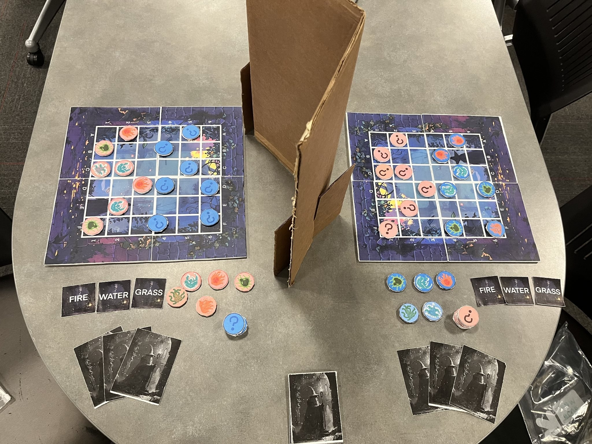
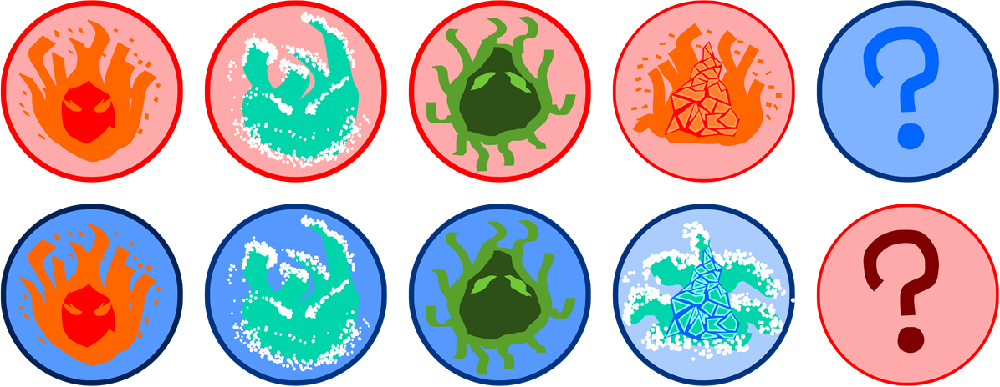
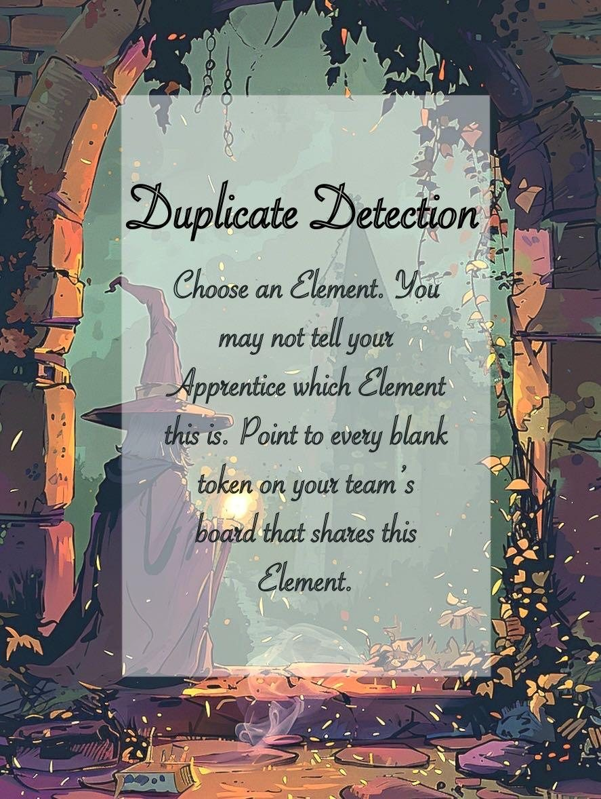
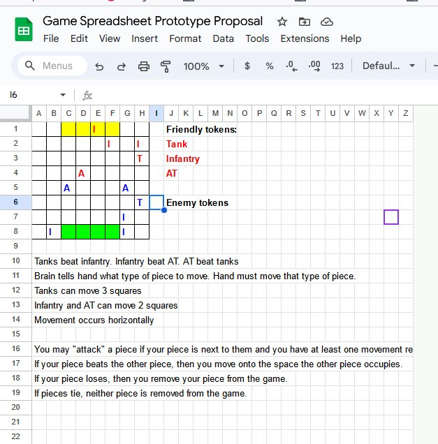
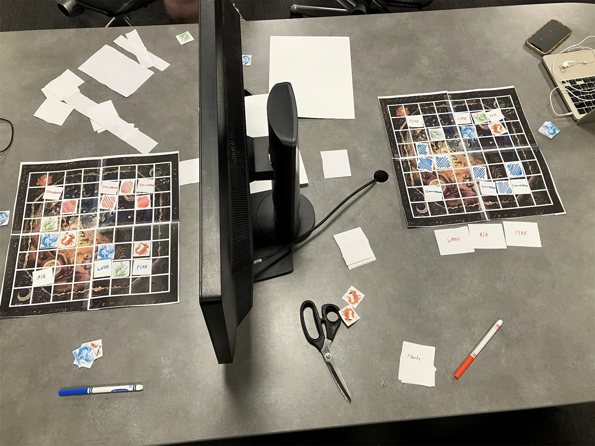
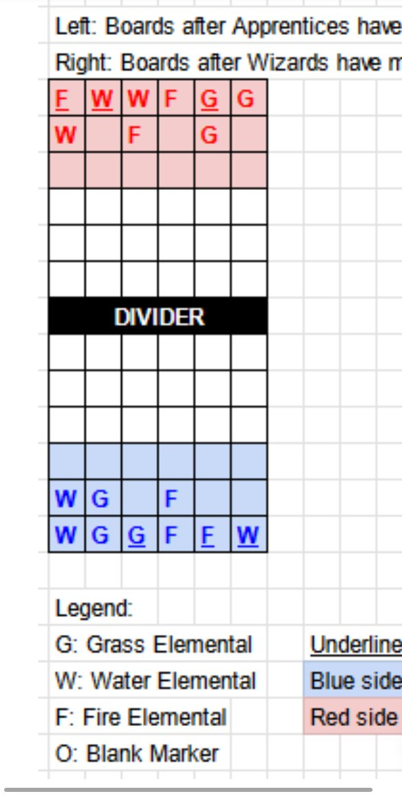
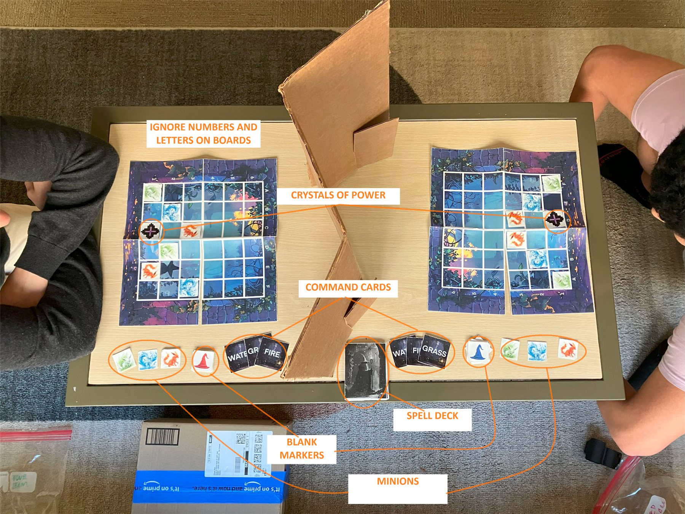
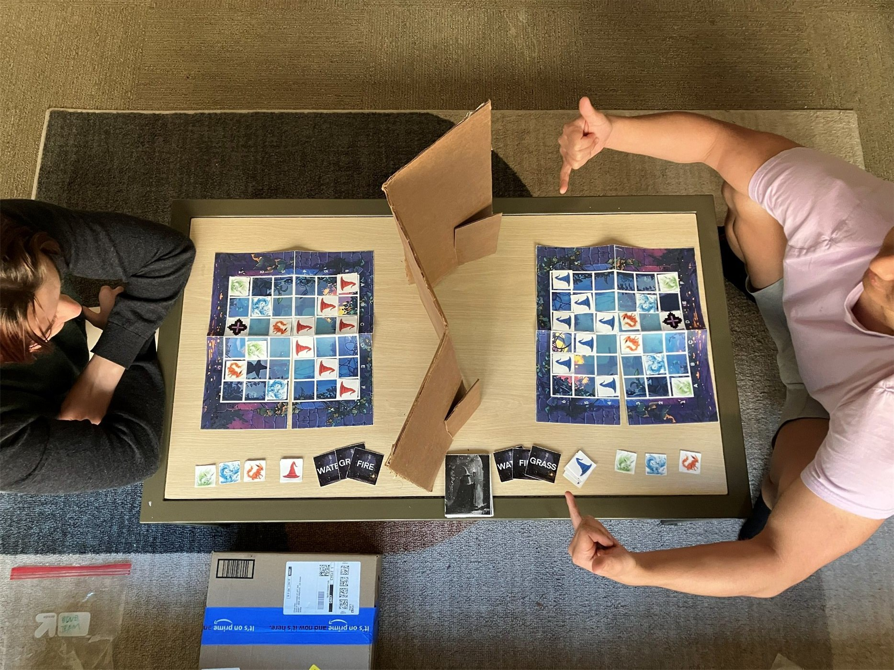
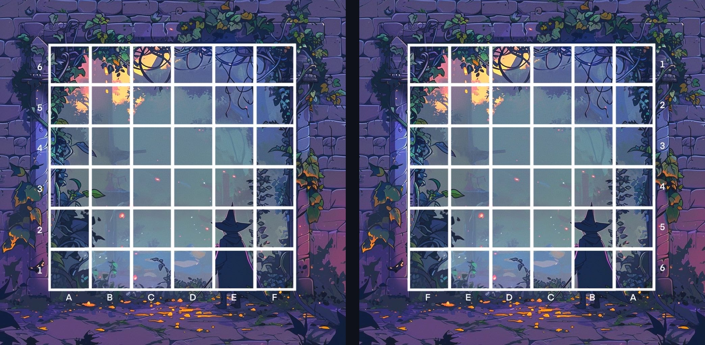

This is my favorite board game project! It's kinda complicated, but if you're a board game fan or have the patience to figure out what's going on, I bet you'll have fun. Before you read, have you heard of [hand-and-brain chess](https://www.chess.com/terms/hand-and-brain-chess)? It's chess with two players on each side. The "brain" can only say a piece type, like "knight", and the "hand" decides which knight to move and where.

Reagan and I had played it before, and we brought this idea to this project. We changed one thing: the brain can see the whole board, but the hand can't. For the overall style we tried to copy Harry Potter. Great novel, isn't it?

## The game

Here's how it works. There are two teams, red and blue, and each team has a **Wizard** and an **Apprentice**. The two Apprentices sit across from each other with a cardboard divider in the middle, and each of them has their own 6×6 board.

The Apprentice is the one moving the pieces. They can see their own pieces, and they know where the enemy pieces are, but every enemy piece just looks like a “?” to them. The Wizard is the opposite. They can see both boards and know everything, but they can't move anything, and they're not allowed to just tell their Apprentice what's going on.

At the start, each Apprentice secretly puts down a **Crystal of Power** and 6 of their 9 minions on their half of the board. The minions are fire, water or grass, and you can pick any mix you want. Then the Wizards copy the other team's layout onto their own board with “?” markers.

<Wide caption="Both boards after setup">
  
</Wide>

Then you take turns. On your turn, the Wizard has to play a Spell card first. After that, they show their Apprentice a Command card, which just says Fire, Water or Grass, and they can't say a word. The Apprentice picks any minion of that element and moves it up to 3 squares, no diagonals and no jumping over pieces. If it ends up next to an enemy piece and still has a move left, it can attack, and you have to say it out loud, like "B4 attacks B3."

Fights work like Pokémon. Fire beats grass, grass beats water, water beats fire. The winner takes the square, the loser's gone, and if they're the same element, nothing happens. The Wizards tell everyone how it went, so every fight gives the Apprentices a little more info about what's under those “?”s.

You win by capturing the enemy's Crystal, or all of their minions. Oh, and the Crystal has an element too, so if you hit it with the wrong one, your minion is the one that dies.

<Figure caption="The final tokens. The “?” markers are in the other team’s color">
  
</Figure>

So the Command card is basically the only way the Wizard gets to talk. Let's say your Wizard sees an enemy grass minion getting close to your Crystal, so they show you Fire. But you don't know which fire minion they mean, or if they want you to attack or just block. You have to guess, and if you guess wrong, your fire minion might walk right into a water one.

Then there are the spells. We decided early on that Wizards shouldn't be able to attack directly, so spells only move pieces around or mess with information. There are 7 of them. Duplicate Detection lets the Wizard pick an element in their head and point at every “?” of that element, without saying which element it is. Soul Swap swaps the elements of two minions, and since the “?” markers don't change, the other Apprentice might still think they know what those are. Levitation lets your Crystal move like a minion for a turn, and it can even attack.

The rest are simpler. Haste lets you move two minions, Polymorph swaps one of your minions for one of a different element, Summon Elemental adds a new minion on the row closest to you, and Transmutation changes your Crystal's element.

<Figure caption="A spell card">
  
</Figure>

I know that's a lot to read, so here's a video playthrough. Shout out to Reagan for making it and explaining everything so well.

<Wide caption="The rules video">
  <YouTube id="KR1s1_OIhdY" title="Spell Showdown rules explanation video" />
</Wide>

## The iterations

I was the producer on this project, and the game itself isn't that hard. The hard part was getting people to understand it fast. That's pretty much what most of our iterations ended up being about.

### Where it started

So it actually started as a war game. We couldn't find a time to meet in person, so our first meeting was a Discord call, and we played the first version in Google Sheets. Tanks beat infantry, infantry beat anti-tank, anti-tank beat tanks, and you moved your pieces with Ctrl+X and Ctrl+V lol.

<Figure caption="The Google Sheets version">
  
</Figure>

It was really hard to play like that, but we liked the mechanic. There was no theme though, and the pieces were hard to tell apart, so we turned it into wizards and elementals and made a paper version.

<Figure caption="The first paper version. We could only find a computer monitor to use as the divider">
  
</Figure>

Back then the elements were fire, air and water. Air became grass pretty soon after. And to win, you had to destroy all 3 of the enemy's "Simulacrum" pieces. Remember that word, it comes back. When we played it ourselves, nobody knew when the Wizard was supposed to cast a spell, so we made every turn the same, one spell and then one command.

### Nobody could learn it

Then we brought it to other people, and that's where things got rough. Our first two playtests both took around **30 minutes** just to set up. 

People thought the Apprentice was a game piece. People put the “?” markers on their own pieces. And nobody knew what a Simulacrum was, which, fair, not everybody is a DnD nerd. But the bigger problem was that people just didn't get the main idea, that one player on each team knows things they can't say. Without that, none of the other rules make sense. So we put a table right at the start of the rulebook showing what each role can see, what they can move, and how they can talk to each other.

Setup was still slow after that. Mostly, people couldn't match the rulebook to the stuff on the table, and to be fair, our setup pictures were spreadsheet cells with letters in them. So we swapped them for labeled photos of a real setup.

<Figure caption="The old setup picture, made in a spreadsheet">
  
</Figure>

<Wide caption="The new one: a real setup with labels">
  
</Wide>

The pieces were a mess too. Red and blue minions looked the same, and people thought the blank markers were their own pieces. We tried little wizard hats as markers for a while, and in the end we went with “?” tokens in the other team's color. Oh, and the pieces were just slips of paper. We did one playtest outside, and the wind blew them all away lol. The final ones have custom art backed with foam board.

<Figure caption="When the markers were wizard hats">
  
</Figure>

Then there were the coordinates. When you attack, you say the squares out loud, like "B4 attacks B3," and the other team's Wizard has to find those squares on their own board. But the two boards face opposite ways, so B3 on one board wasn't B3 on the other. So we flipped the letters and numbers on one board, and now B3 is the same square on both.

<Wide caption="The two team boards, rotated 180°">
  
</Wide>

We also split the rules into a short main rulebook plus a cheat sheet for each role, so you only have to read your part.

Even after all that, people still took a while to learn. They had fun once they got it, though. Then one group told us something that changed how we thought about it. They usually learn new games pretty fast, but only because someone who already knows the game teaches them. We can't go teach everyone who plays our game. So Reagan made the rules video you saw above, and we put a QR code for it on the first page of the rulebook.

### Balance

When our friends finally played a full game, they really liked it. They said the strategy was deep and complex, and both the Wizards and the Apprentices felt like they mattered. But that game took **45 minutes**, and one team pretty much won because they drew 3 of the 4 Summon Elemental cards.

This is where the Simulacra come back. 3 Simulacra became 1 Crystal of Power, and we added the other way to win, capturing all the minions. Games got shorter, and no more DnD words. We also made it so a summoned minion can't move on the turn it shows up.

### Some thoughts

If I made it again, I'd probably cut some of the Pokémon-style element stuff and some of the spells, since that's a lot to learn. But those are also a big part of what makes the game fun and original, so honestly, I'm torn on it.

This was my last board game project, and the most complicated one. My teammates and I put a lot into it, so thanks to them!

I'm more of a coder, but these board game projects really opened up how I think about games, both as a designer and as pretty much every other role in game production. On this one I was the producer, which is a very different job from writing code.

The biggest thing I took away is that the player matters most. Your game being good doesn't mean players will love it. Spell Showdown is the best example. The people who made it through setup loved the strategy, but a lot of people never got that far. Date Dash was kind of the opposite. Players didn't care about winning at all, they just wanted the drama, so we changed the game to fit them. 
All of this happened pretty early in my time making games, and these projects were a really valuable experience. I really want to make a board game full iteration again, you know, to escape from programming world haha.
