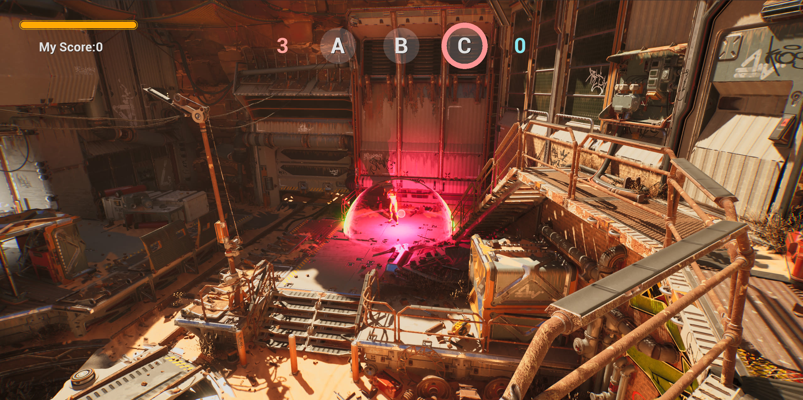
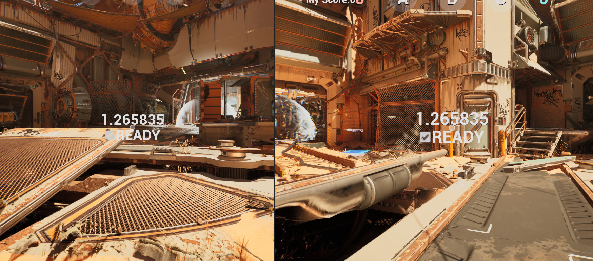
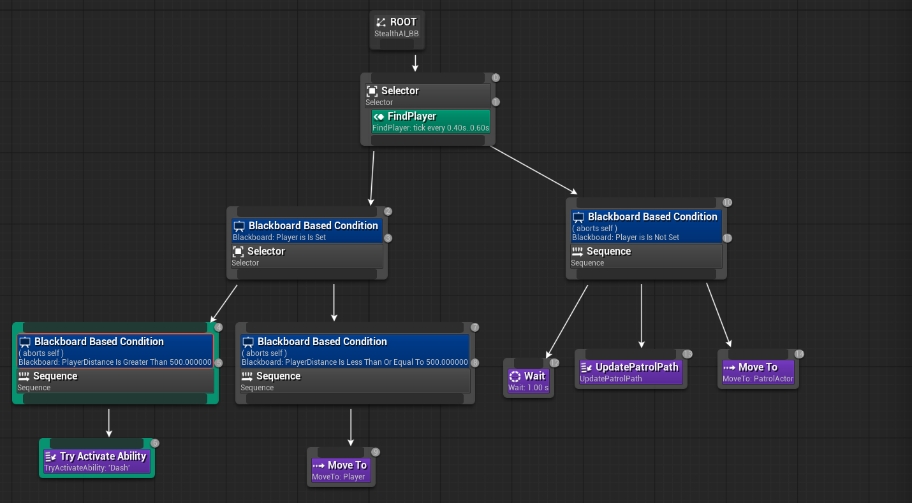

import FireFlow from '../../../components/diagrams/FireFlow.astro';
import CaptureStates from '../../../components/diagrams/CaptureStates.astro';
import showcase from './ShowCase.mp4';
import hudClip from './clip-hud.mp4';
import eosClip from './clip-eos.mp4';
import chatClip from './clip-chat.mp4';
import graffitiClip from './clip-graffiti.mp4';
import stealthClip from './clip-stealth.mp4';

I made this project to learn Unreal Engine, spent a while deciding what kind of game to make and went with an FPS, because everybody loves it.

To keep it easy to pick up, the mode is basically King of the Hill, like in Battlefield. Two teams fight over a few areas on the map, and holding them earns points until one team wins.

Here's the trailer recorded under play on listen server (2 Players):
<Wide xl>
  <Video src={showcase} wide controls />
</Wide>

## How to play

It's up to 2v2, red vs. blue. Log in with your Epic account, then host a match or join one (more on EOS later). Teams balance themselves, and the match starts once everyone hits Ready.

The map has three points, A, B and C. Stand in one to capture it. Every point your team owns gives you 1 point per second, and first to 200 wins. Looking back, 200 is way too high lol, I wasn't thinking much about game design back then.

If the other team already has progress on a point, you have to drain theirs back to 0 before yours starts filling. If both teams are on it, nothing moves.
Dead players don't count, so to take a contested point you have to win the fight on it. You respawn after 5 seconds, and there's no friendly fire.

There's all/team chat, kill streak announcements, and graffiti you can spray on walls, like in Valorant or OW where you tag the spot after a cool kill. The graffiti gets saved, so it's still there next match.

## Capture Point

### Who does what

Before writing any code I split the mode into three classes, each with one job:

| Class | Job |
|---|---|
| `CapturePoint` | One per point. Looks at who's standing in it and moves its progress. |
| `CaptureGameState` | Stores every point's progress, owner and the team scores, replicates them, and broadcasts events when they change. |
| `CaptureGameMode` | Match flow. Starts the score timer, checks the win condition, ends the match. |

The points and the GameMode only run on the server. The GameState is the one thing every client sees, so all the state the HUD needs lives there.

### One float per point

Each point's whole state is one float between -1 and 1. Negative leans red, positive leans blue, and the size is how far along it is.

```
-1 ←—— red owns ——— 0 (neutral) ——— blue owns ——→ +1
```

I went with this because a point can only lean one way at a time. With one signed number there's no "red progress" and "blue progress" to keep in sync, and the owner is just the sign.

### Two states

A point is either still being fought over or already owned, and the rules are different for each. So each point is a tiny state machine, and `Tick` just picks which function to run:

<CaptureStates />

```cpp title="CapturePoint.cpp"
void ACapturePoint::Tick(float DeltaSeconds)
{
	Super::Tick(DeltaSeconds);
	if (!HasAuthority()) return; // server only

	if (isOwnedByTeam) OwnedByTeam(DeltaSeconds);
	else               ContestingPoints(DeltaSeconds);
}
```

| On the point | Contesting | Owned |
|---|---|---|
| Only one team | Drains the other side back to 0, then fills toward its own side | The owner holds it at full. Attackers push it toward 0 |
| Both teams | No change | No change |
| Nobody | Falls back to 0 | Refills toward the owner |

### Taking a point

The part I like most is the first row, like if blue has some progress on a point and red walks in, red can't just start filling it. Red first drains blue's progress back to 0, and only then starts counting toward red.

```cpp title="CapturePoint.cpp"
if (bRedOnly)
{
	// Red on the point: pull blue's progress back to 0 first, then grow red
	if (Value > 0.f)
	{
		Delta = -DecaySpeed * DeltaSeconds;
	}
	else
	{
		Delta = -CaptureSpeed * DeltaSeconds;
	}
}
// ...blue is the mirror, both teams = no change, nobody = decay back to 0
float NewValue = FMath::Clamp(Value + Delta, -Goal, Goal);
```

Draining (0.2/s) is twice as fast as capturing (0.1/s). A capture takes 10 seconds, so the other team has time to react and undo it fast. And since owned points refill, you have to actually stay on a point to take it.

### Only living players count

{/* ❓ Scott: confirm this is why you moved from overlap events to recounting every frame */}
My first idea was to count players with overlap begin/end events, but it breaks when someone dies inside the circle, because they never "leave" it. So the point recounts every frame on the server, and skips anyone who's ragdolling, since in this template ragdoll means dead.

```cpp title="CapturePoint.cpp"
for (TActorIterator<AShooterCharacter> It(GetWorld()); It; ++It)
{
	AShooterCharacter* Char = *It;
	if (!CaptureArea->IsOverlappingActor(Char)) continue;
	if (Char->GetMesh()->IsSimulatingPhysics()) continue; // dead
	if (Char->Team == EShooterTeam::Red)       ++LiveRedCount;
	else if (Char->Team == EShooterTeam::Blue) ++LiveBlueCount;
}
```

With four players and three points, looping over every character every frame costs nothing, and it's always correct.

### Score and UI

Score runs on a 1-second timer in the GameMode, and in each tick, every point a team owns adds 1 to its score, so scores stay whole numbers. At 200 the timer stops and the match ends.

The HUD doesn't poll anything. The GameState fires a delegate from its OnRep, and each ring turns the signed float back into a 0–1 fill on a dynamic material, tinted by the owner:

```cpp title="CaptureGameState.cpp"
OutRed  = FMath::Clamp(-CaptureProgress[i], 0.f, CaptureGoal) / CaptureGoal;
OutBlue = FMath::Clamp( CaptureProgress[i], 0.f, CaptureGoal) / CaptureGoal;
// then: RingMaterial->SetScalarParameterValue("Progress", Fill)
```

### Making it readable

For the final version I worked on making the objective easy to read at a glance. Each capture zone glows red or blue depending on who owns it, so you can tell from across the map. 

<Wide xl caption="Point C owned by red. The dome and the C icon both switch to the owner's color.">
  
</Wide>

<Wide caption="The top of the HUD mid-match: B fills red, C fills blue, and each team's score ticks up once a second for every point it owns.">
  <Video src={hudClip} wide />
</Wide>

## Server-authoritative combat

Whoever hosts is the server (a listen server), and the server decides everything that matters. Clients only ask, replication stuff.

<FireFlow />

When you click, your client calls a Server RPC. The server runs the actual weapon logic. After spawning the bullet, it tells every machine to play the shot with a Multicast:

```cpp title="ShooterCharacter.h · ShooterCharacter.cpp · ShooterWeapon.cpp"
UFUNCTION(Server, Reliable)
void ServerDoStartFiring();

void AShooterCharacter::ServerDoStartFiring_Implementation()
{
	if (CurrentWeapon) CurrentWeapon->StartFiring(); // runs on the server
}

// in AShooterWeapon::FireProjectile, after spawning the bullet:
SetBullets(--CurrentBullets);
MulticastFireProjectile(); // animation + sound on every machine
```

Firing is `Reliable`, since a lost shot feels like a bug. Stopping the fire sound is `Unreliable`, since it's just cosmetic.

Hits are only checked on the server, so a client can't fake one. Friendly fire gets skipped there too:

```cpp title="ShooterProjectile.cpp"
if (HitShooterChar && InstigatorShooterChar &&
	HitShooterChar->Team == InstigatorShooterChar->Team)
{
	return; // same team, no damage
}
```

Health, ammo and team use RepNotify, so each client updates its own HUD. Control rotation is replicated too, so others can see you aim up and down.

But the host sets these values itself, so its OnRep never fires and its HUD didn't update. So on a listen server I call it by hand:

```cpp title="ShooterWeapon.cpp"
void AShooterWeapon::SetBullets(int32 CBullets)
{
	CurrentBullets = CBullets;
	if (GetNetMode() == NM_ListenServer)
	{
		OnRep_CurrentBullets();
	}
}
```

## Playing online with EOS

The packaged game runs on Epic Online Services. It all lives in a `GameInstanceSubsystem`, so it survives map travel.

Login tries saved credentials first and only opens Epic's web login if that fails, so you only see the browser once.

```cpp title="MultiOnlineSubsystem.cpp"
AuthInterface->Login(MoveTemp(Params)).OnComplete([this, CredentialsType](const auto& Result)
{
	if (Result.IsOk())
	{
		AccountInfo = Result.GetOkValue().AccountInfo.Get();
	}
	else if (CredentialsType == LoginCredentialsType::PersistentAuth)
	{
		LoginHelper(LoginCredentialsType::AccountPortal); // fall back to the web login
	}
});
```

It's also turned off in the editor (`ShouldCreateSubsystem` returns false `WITH_EDITOR`), so PIE testing doesn't make me log in every time.

Hosting creates a 4-player lobby with the map name on it, then loads that map as a listen server. Joining skips any lobby whose map doesn't match your mode:

```cpp title="MultiOnlineSubsystem.cpp"
for (const TSharedRef<const FLobby>& Lobby : FindResults.Lobbies)
{
	const FSchemaVariant* MapVar = Lobby->Attributes.Find(FSchemaAttributeId(SETTING_MAPNAME));
	if (!MapVar || MapVar->GetString() != DesiredMap) continue;

	// join it, ask EOS for the host's address, then ClientTravel there
}
```

Putting the map on the lobby means there's no separate "game mode" field to keep in sync. The map already decides the mode.

<Wide xl caption="Two packaged builds: log in with Epic, authorize the app, host on one machine and join from the other.">
  <Video src={eosClip} wide />
</Wide>

## Teams, spawns and ready-up

New players join the team with fewer people (ties go to red). Spawn points are tagged Red, Blue or BackUp in the editor. I keep your team's spawns, drop any with an enemy within 10 meters, and fall back to BackUp if nothing's left:

```cpp title="ShooterGameMode.cpp"
UnOccupiedStartPoints.RemoveAll([&](const APlayerStart* Start)
{
	for (TActorIterator<AShooterCharacter> It(World); It; ++It)
	{
		if (It->Team != Team &&
			FVector::Dist(Start->GetActorLocation(), It->GetActorLocation()) < 1000.0f)
			return true; // enemy too close
	}
	return false;
});
```

Ready is a Server RPC, and once every player is ready a countdown starts. The countdown only replicates once, then each machine counts down on its own. Only the server starts the match, so a client being slightly off doesn't matter:

```cpp title="ShooterGameState.cpp"
DOREPLIFETIME_CONDITION(AShooterGameState, WaitingToStartTime, COND_InitialOnly);

WaitingToStartTime -= DeltaSeconds;
if (WaitingToStartTime <= 0.0f && HasAuthority())
{
	GameMode->StartMatch();
}
```

<Wide caption="Two clients mid-countdown. Each counts locally, and they still land on the same number.">
  
</Wide>

## Chat and kill streaks

If you don't wanna use Discord, this game has game chat...

A message goes to the server with a Server RPC. The server picks who should get it and sends it to each of them with a Client RPC:

```cpp title="ShooterPlayerState.cpp"
void AShooterPlayerState::SendChatMessage_Implementation(EShooterTeam PlayerTeam,
	const FString& SenderName, const FString& MessageText)
{
	for (APlayerState* PS : GetWorld()->GetGameState()->PlayerArray)
	{
		AShooterPlayerState* Other = Cast<AShooterPlayerState>(PS);
		// None = all chat, otherwise only the same team
		if (Other && (PlayerTeam == EShooterTeam::None || Other->Team == PlayerTeam))
		{
			Other->ReceiveChatMessage(PlayerTeam, SenderName, MessageText); // Client RPC
		}
	}
}
```

The filtering happens on the server on purpose. Enemies never receive your team messages at all, so there's nothing on their machine to dig out.

Kill streaks live on the PlayerState too. At 3, 5, 7 and 9 kills everyone gets a colored announcement ("X is UNSTOPPABLE!"), a little stupid, through a Multicast on the GameState, plus a sound.
<Wide xl caption="Shut up dude xD">
  <Video src={chatClip} wide />
</Wide>

## Graffiti that stays

Pick a tag with 1–5 and press X to spray it on whatever you're looking at within 5 meters. The server does the line trace and spawns a decal there.

The tricky part is laying the decal flat on the surface. I build a quaternion that turns the decal's forward axis (+X) to face into the hit normal:

```cpp title="ShooterPlayerController.cpp"
float Dot = FVector::DotProduct(FVector::XAxisVector, -HitResult.Normal);
if (Dot == 1.0f)       Quaternion = FQuat::Identity;                    // already facing it
else if (Dot == -1.0f) Quaternion = FQuat(FVector::ZAxisVector, UE_PI); // exactly opposite
else
{
	FVector Axis = FVector::CrossProduct(FVector::XAxisVector, -HitResult.Normal);
	Axis.Normalize();
	Quaternion = FQuat(Axis, FMath::Acos(Dot));
}
```

The special cases are there because parallel vectors have no cross product to rotate around. Walls then get 90° of roll so the image is upright, and floors use your yaw so the tag faces you.

Each tag's transform and class go into a save game, saved async every 5 seconds so it never stalls the game. Next match, they're all spawned back.

<Wide xl caption="GGs. Save to next game">
  <Video src={graffitiClip} wide />
</Wide>

## Before the FPS: a top-down stealth game

I tried out other parts of UE with a small top-down stealth level on UE's Top Down template. The FPS mostly kept the same setup.
### GAS: attributes and tags

Health, max health, move speed and damage are GAS attributes. The attribute set turns that into health loss in one place:

```cpp title="TopDownAttributeSet.cpp"
void UTopDownAttributeSet::PostGameplayEffectExecute(const FGameplayEffectModCallbackData& Data)
{
	if (Data.EvaluatedData.Attribute == GetDamageAttribute())
	{
		float DamageValue = GetDamage();
		if (Data.Target.HasMatchingGameplayTag(InvulnTag)) DamageValue = 0.0f;

		SetHealth(FMath::Clamp(GetHealth() - DamageValue, 0.0f, GetMaxHealth()));
		SetDamage(0.0f); // consumed
	}
}
```

Having one place for damage means things like invulnerability are one `if`, and every damage source gets it for free.

States like crouching, immobile, invulnerable and dead are gameplay tags. Other systems just check the tag. For example, the movement component returns a max speed of 0 while you have the Immobile tag:

```cpp title="TopDownCharMovementComponent.cpp"
float UTopDownCharMovementComponent::GetMaxSpeed() const
{
	if (ASC->HasMatchingGameplayTag(ImmobileTag)) return 0.0f;
	return TopDownChar->DefaultAttributeSet->GetMoveSpeed();
}
```
I do love GAS, pretty flexible and useful.

### Behavior tree AI

<Wide xl caption="The enemy's behavior tree. No player in sight: wait, pick the next patrol point, walk there. Player spotted: Dash at them if they're over 5 meters away, otherwise just walk up.">
  
</Wide>

I use this making a stealth demo. How far an enemy can see depends on your threat level (Check the vid caption below). Moving raises it, crouching and stealth zones lower it, and the FindPlayer service turns each level into a view cone, from 30° and 1 meter up to 90° and 40 meters. It still needs a clear line trace, so walls block it.

```cpp title="TopDownCharacter.cpp · BTService_FindPlayer.cpp"
int ThreatOffset = 0;
if (GetVelocity().SizeSquared() > KINDA_SMALL_NUMBER) ThreatOffset += 1;
if (bIsCrouched) ThreatOffset -= 1;
ThreatOffset -= ASC->GetGameplayTagCount(StealthTag);
int Level = FMath::Clamp(3 + ThreatOffset, 0, 4);

const float ThreatAngles[]    = {0.52f, 0.70f, 0.87f, 1.22f, 1.57f}; // half-angle, radians
const float ThreatDistances[] = {100.f, 250.f, 500.f, 2000.f, 4000.f};
```

<Wide xl caption="The little star up top is your threat level. Crouch in the grey stealth zones and it drops, so a patrol has to almost walk into you before it notices.">
  <Video src={stealthClip} wide />
</Wide>
